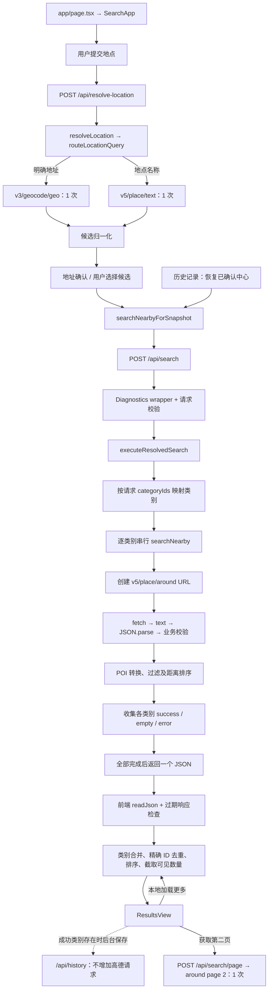
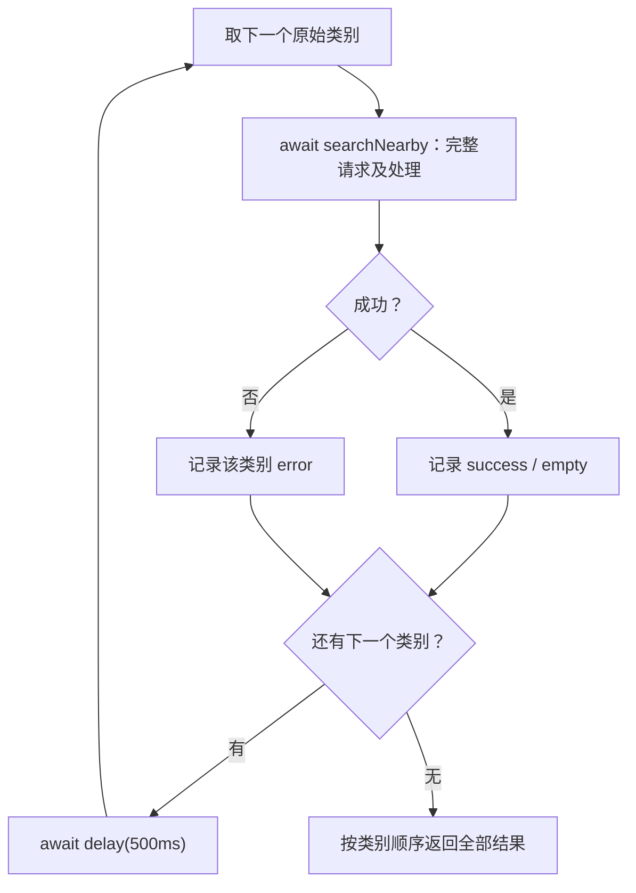

# 历史研究归档（2026-11-03 整理）

原文来源：PR #23，提交 d382553。研究针对当时的串行／固定间隔基线；后续 #21、#30、#32 已实现准入、时间治理及两类并行。本文保留研究依据，当前行为见 README 和 PLANS。

---

# Nearby 搜索性能优化 — Stage B 只读技术调研

## 1. Executive Summary

1. **CONFIRMED：调度是当前主要研究对象。** 用户提供的真实 Preview 三类别请求约 4,086ms，其中上游 fetch 合计约 3,067ms、固定等待约 1,002ms；JSON、转换、排序不是主要瓶颈。本轮直接采用这些数据，没有重复采样。
2. **INFERRED：只取消等待，三类别约可从 4.09 秒降至 3.08 秒。** 这是保持单请求耗时不变的算术估算，约减少 24.5%，不是实际优化结果。
3. **INFERRED：并发两个类别有进一步收益空间。** 按同组三个请求耗时推演，理想调度约需 2.0 秒加其他开销；实际连接、网络竞争和限流可能改变这个结果。
4. **CONFIRMED：单类别 bakery 不会从类别并发或删除类别间等待中直接获益。** 单类别没有该等待，2,670ms 的 fetch 时间也不能直接解释为高德内部处理时间。[`src/search/service.ts:25–47`][service-loop]、[`src/amap/client.ts:46–69`][client-request]
5. **CONFIRMED：类别顺序属于兼容性契约。** 前端跨类别去重保留先遇到的 POI；并发后必须按请求原始索引返回，不能按完成顺序追加。[`src/web/logic.ts:64–85`][merge]
6. **CONFIRMED：单请求并发限制不是全局配额保护。** 官方配额存在服务、账号、Key 等维度；Production、Preview 和同账号其他消费者可能竞争预算。[高德 QPS/配额规则][amap-pricing]
7. **CONFIRMED：当前没有搜索链路的应用级 deadline、取消传播、自动重试或全局 limiter。** 请求序号只防止旧响应覆盖 UI，不停止上游请求。[`src/web/SearchApp.tsx:194–235`][ui-search]、[`src/amap/client.ts:46–69`][client-request]
8. **建议：Preview 小范围优先评估 C——并发上限 2，加独立启动节奏；广泛开放前再评审 D 的全局保护。** 具体速率须人工核实配额。裸 `Promise.all` 不构成限流。此建议没有获得实施授权。

### 报告范围、状态与证据口径

- 调研日期：2026-10-23；文档交付日期：2026-10-24，Asia/Shanghai。
- 状态：**调研已完成，存在明确标注的外部未知项；等待用户和 ChatGPT 审查，不进入 Stage B 实施。**
- 仓库：`JKd121/nearby-places`。源码调查快照：Stage A 分支 `perf/search-observability` 的 `cff77941ee169e9bdbf308d1743e5be7e88313b8`。
- 该快照包含 Diagnostics Draft PR #15 的代码；**不表示这些代码已经合入 master**。所有源码链接固定到该 commit，报告在独立文档分支中仍可准确定位证据。
- 文档分支基线：fetch 后的 `origin/master`，`3bc08d4f7636b72c7206f1d9e4cb6272c212e41b`。本次唯一允许的文件变更为本报告，不更新 Harness 或其他项目文件。
- 只读核查确认 [Diagnostics PR #15][diagnostics-pr] 仍为 Draft、未合并，head 仍为上述 Stage A 快照。本轮不改变其状态。
- **CONFIRMED**：有源码、项目历史记录、官方文档或用户明确提供的实测证据；注明来源类型。
- **INFERRED**：依据证据推导，未通过本轮实验直接证明。
- **UNKNOWN**：无法由当前源码和公开资料确定，必须另行核实。
- 本轮没有读取真实 Key、环境文件或生产数据库，没有运行真实高德请求、压测或 Preview 实验；没有修改功能代码、配置、依赖、Production 或部署设置。
- 章节 7–9 是待审查建议，不是已批准的方案；没有实现任何建议参数、开关、调度器或基础设施。

### 用户已确认的 Stage A 实测基线

| 场景 | 用户提供的已确认事实 |
| --- | --- |
| 调度 | 类别串行，相邻类别完成后固定等待 500ms |
| 单类别 bakery | 服务端 2,677ms，其中 `amap.fetch` 2,670ms |
| 三类别 hotel → hotpot → billiards | 服务端约 4,086ms；fetch 分别约 1,039 / 1,057 / 971ms |
| 三类别等待 | 两次各约 501ms |
| 非主要瓶颈 | JSON 解析、数据转换、排序 |
| fetch 的含义 | 调用 fetch 至收到响应头，不等于高德服务器内部处理时间 |

这些事实来源于本任务用户提供的真实 Preview 结果。未取得原始导出文件的独立副本；没有伪造原始样本、重复测量或把此前本地 Mock 日志当成真实基线。

## 2. Current Architecture

### R1：完整调用链

完整链路源码定位：

| 环节 | 文件路径与行号 |
| --- | --- |
| 页面入口 | [`app/page.tsx:1–3`][page] |
| 解析提交、候选处理与确认 | [`src/web/SearchApp.tsx:150–180`][ui-resolve] |
| 历史直接搜索 | [`src/web/SearchApp.tsx:115–139`][ui-history] |
| 两条 API Route | [`app/api/resolve-location/route.ts:9–23`][route-resolve]、[`app/api/search/route.ts:9–21`][route-search] |
| 请求关联与 handler 总计时 | [`src/server/diagnostics/request.ts:8–28`][diag-request] |
| 类别、中心和半径校验 | [`src/search/validation.ts:27–37、63–73`][validation] |
| 地点意图分流 | [`src/location/router.ts:19–21`][location-router]、[`src/location/resolver.ts:6–16`][resolver] |
| 高德 provider/client 工厂 | [`src/server/amap.ts:12–21`][server-amap] |
| 类别调度、搜索响应与第二页 | [`src/search/service.ts:25–65`][service-loop] |
| 请求创建、发送、读取与转换 | [`src/amap/client.ts:46–69、94–117`][client-request] |
| 结果呈现及异步保存历史 | [`src/web/SearchApp.tsx:209–235`][ui-search] |
| 第二页前端及后端 | [`src/web/SearchApp.tsx:247–269`][ui-page]、[`app/api/search/page/route.ts:16–29`][route-page] |

**CONFIRMED：不存在先 POI、失败后自动再 geocode 的多级回退。** resolver 在两个分支中二选一。用户确认候选不再调用高德。核心中保留的 `executeSearch()` 会先 geocode，但当前 `/api/search` 使用的是 `executeResolvedSearch()`，不会重新解析地点。[`src/location/resolver.ts:6–16`][resolver]、[`src/search/service.ts:50–59`][service-execute]、[`app/api/search/route.ts:19`][route-search]

**CONFIRMED：其他串行 await 主要是有数据依赖的处理步骤。** 包括读取请求 JSON、fetch 到响应头、读取响应文本、解析/校验，以及前端读取返回 JSON。历史保存使用 `void history.save(...)`，在结果设置之后发起，不阻塞结果展示。[`src/amap/client.ts:46–69`][client-request]、[`src/web/SearchApp.tsx:209–231`][ui-search]

公交站与地铁站同样使用 around 的 POI 类别查询，没有额外公交线路、时刻表或详情查询。[`src/amap/categories.ts:15–18`][categories]、[`src/amap/client.ts:94–101`][client-nearby]

### 类别生成与排序

**CONFIRMED：** 配置共有 10 类：hotel、mall、hotpot、bakery、dessert、ktv、billiards、gym、bus、subway。普通页面的全选和切换按配置顺序生成；API 校验保留传入数组顺序；历史记录保存会先去重再按字母排序，回放直接使用保存数组。因此兼容目标应为“每次请求的原始顺序”，不能统一重排为配置顺序。[`src/amap/categories.ts:6–18`][categories]、[`src/web/logic.ts:25–57`][selection]、[`src/search/validation.ts:27–37`][validation]、[`src/history/service.ts:17–25`][history-normalize]、[`src/web/SearchApp.tsx:121–139`][ui-history]

### 一次搜索产生多少高德请求

以下是应用逻辑发起的 fetch 次数，不将底层连接尝试等同于业务 API 调用，也不承诺网络层没有重定向等额外往返。

| 场景 | 逻辑调用数量 |
| --- | ---: |
| 请求在校验阶段被拒绝 | 0 |
| 一次地点解析 | 1：geocode 或 POI text |
| 已确认中心，搜索 N 类 | N 次 around |
| 新地点解析后完成首次 N 类搜索 | N＋1 |
| 历史直接搜索 N 类 | N |
| 手动请求某类别第二页 | 每次额外 1 次 around |
| 本地筛选、排序、展开已取得结果 | 0 |

依据：[`src/location/resolver.ts:6–16`][resolver]、[`src/search/service.ts:55–65`][service-execute]、[`src/web/SearchApp.tsx:115–139、245–269`][ui-history]、[`src/web/logic.ts:129–175`][page-logic]。

当前十类全选，不是固定八类。一次无重试、无重新搜索的“解析＋首次全选搜索”最多 11 次；随后成功获取每类第二页可达 21 次。第二页失败后可再次手动尝试，连续重新搜索也增加调用，因此整个会话没有硬调用预算。[`src/amap/categories.ts:6–18`][categories]、[`src/web/logic.ts:129–133`][page-logic]、[`src/web/SearchApp.tsx:247–269、391`][ui-page]

### R2：当前串行调度流程

该图直接对应 [`src/search/service.ts:25–47`][service-loop]，没有额外后台队列。

## 3. Confirmed Facts

### R2：500ms 的位置、触发条件及原始目的

- **CONFIRMED：** `realDelay` 使用 Promise 和 `setTimeout`；调度函数默认间隔 500ms，正式 confirmed search 也显式传入 500。[`src/search/service.ts:15、30–31、55–57`][service-loop]
- **CONFIRMED：** 等待在前一类别完整操作结束或被捕获为失败之后，下一类别开始之前。单类别和最后一类之后不等待，成功与失败都不跳过中间等待。[`src/search/service.ts:35–45`][service-loop]
- **CONFIRMED：** 相邻启动间隔约等于“前一类别完整耗时＋500ms”，不是每隔 500ms 启动一次。[`src/search/service.ts:37–45`][service-loop]
- **CONFIRMED（历史文档证据）：** 2026-09-10 修复计划记录了八类别 `Promise.all` 突发导致 QPS 问题，提出串行及500ms间隔；最后的批准明确仅相邻类别间等待、不在末项后等待。[`harness/build/2026-09-10-amap-qps-hong-kong-fix-plan.md:5–10、44–45`][qps-plan]
- **CONFIRMED（Git 证据）：** 只读 `git show 8d20ebe:src/search/service.ts` 与 `git blame` 显示初始提交 `8d20ebe` 已有串行循环和末项跳过等待；Stage A 的 `42d9792` 为其添加计时，没有移除间隔。[初始提交的 service.ts][initial-service]
- **CONFIRMED：** 搜索/provider/client链路未发现其他应用级固定等待、重试或退避。历史模块另有200ms预读、8秒超时和写入队列，它们不调度高德搜索。[`src/web/search-history-store.ts:50–86、245`][history-store]、[`src/amap/client.ts:46–69`][client-request]、[`src/location/provider.ts:27–59`][provider-request]

**INFERRED：** 现有间隔是早期突发问题的保守修复，不是当前官方配额的证明，也不能保证多用户总流量安全。旧计划早先关于“末项也等”的描述已被最终批准及实际代码覆盖，不能引用为当前行为。

### R3：高德接口、配额与调用规则

| 用途 | 使用接口 | 代码与官方文档 |
| --- | --- | --- |
| 地址解析 | `GET /v3/geocode/geo` | [`src/amap/client.ts:5、84–92`][client-geocode]；[官方地理编码][amap-geocode] |
| 地点候选 | `GET /v5/place/text`，搜索POI 2.0 | [`src/location/provider.ts:6、27–29`][provider-request]；[官方POI 2.0][amap-poi] |
| 类别周边及第二页 | `GET /v5/place/around`，搜索POI 2.0 | [`src/amap/client.ts:6、94–101`][client-nearby]；[官方POI 2.0][amap-poi] |

**CONFIRMED（官方）：** 当前流量说明没有给出本账号可直接套用的固定 QPS 数字，要求前往“控制台→流量分析→配额管理”查询。不能引用旧网文中的默认数值代替控制台。[官方流量限制说明][amap-flow]

**CONFIRMED（官方）：** QPS按服务提升，同账号所有Key共用该服务额度。公开计费将地理编码归入基础LBS服务组，关键字/周边归入基础搜索服务组，说明了服务组月配额和跨平台共享。因此日/月用量与每秒启动频率是不同约束。[官方服务与配额说明][amap-pricing]

**UNKNOWN：** 本账号的认证/授权类型、实际QPS、日/月余额、附加流量包，以及text和around在控制台是否共用同一个QPS桶。需要人工查看控制台，不需要向报告提供Key。公开服务组口径不足以断言每个版本、接口都使用同一速率桶。

重点错误码及官方含义概括：

| 错误码 | 相关限制 |
| --- | --- |
| `10003`、`10044` | 日用量；后者明确为账号维度 |
| `10004` | 短时间访问过密，涉及分钟窗口封停 |
| `10010` | 出口IP相关访问超限 |
| `10015` | 单机QPS限制 |
| `10019` | 服务总体QPS限制 |
| `10020` | Key在某服务接口上的QPS限制 |
| `10021` | 账号在某服务接口上的QPS限制 |
| `40000` | 可用付费余额耗尽 |

来源：[高德官方错误码说明][amap-errors]。POI响应另有业务 `status`、`info`、`infocode`，HTTP成功不能代替业务成功检查。[官方POI响应说明][amap-poi]

**UNKNOWN：** 未找到官方对任意账号承诺“允许同时N个在途请求”的条款。官方以QPS描述并发能力提升，不足以证明具体在途上限、滑动窗口算法或突发容忍值。未见禁止并发不等于允许无限并发。

### R4：Fetch、连接与部署环境

| 项目 | 结论与证据 |
| --- | --- |
| Runtime | **CONFIRMED：** search、resolve和page三条Route均声明 `nodejs`。[`app/api/search/route.ts:7`][route-search]、[`app/api/resolve-location/route.ts:7`][route-resolve]、[`app/api/search/page/route.ts:7`][route-page] |
| 版本 | **CONFIRMED：** lockfile为Next.js 16.3.3，CI使用Node 24。调研进程本地为Node 24.19.0、内置Undici 7.29.0；不是Vercel patch版本证据。[`package-lock.json:2652–2653`][lock-next]、[`.github/workflows/ci.yml:26–29`][ci-node] |
| Function区域 | **CONFIRMED：** 仓库未声明 `preferredRegion`，没有跟踪的 `vercel.json` 区域配置；`next.config.ts`只配置strict mode与扩展名解析。**UNKNOWN：** 控制台实际区域和部署覆盖。[`next.config.ts:3–12`][next-config] |
| fetch | **CONFIRMED：** 服务端传入运行环境的全局 `fetch`，没有应用自建HTTP客户端或自定义dispatcher。[`src/server/amap.ts:12–21`][server-amap] |
| timeout/retry | **CONFIRMED：** 高德fetch未传signal、deadline或重试配置，链路无应用重试循环。[`src/amap/client.ts:46–69`][client-request]、[`src/location/provider.ts:27–59`][provider-request] |
| HTTP连接复用 | **INFERRED：** 有复用可能；Node fetch基于Undici，Agent使用连接池。不能证明某次Preview请求实际复用了连接，也不能跨独立实例共享连接。[Node fetch][node-fetch]、[Undici Agent][undici-agent] |

Vercel官方说明新项目Node Function默认区域为 `iad1`，但控制台可修改。**不能据此断定本项目在美国，也不能将现有耗时归因为跨境网络。** 静态资源接入点也不等于实际Function执行区域。[官方区域配置][vercel-region]

#### 能否进一步观察DNS/TCP/TLS/响应头等待

- **CONFIRMED（官方）：** Undici诊断通道提供request create、发送请求头、收到响应头、beforeConnect、connected、connectError；连接事件不保证属于某个具体请求。[Undici 7.29诊断通道][undici-diagnostics]
- **CONFIRMED（官方）：** Node socket提供DNS `lookup`、TCP `connect` 和TLS `secureConnect` 事件。[Socket文档][node-net]、[TLS文档][node-tls]
- **INFERRED：** 后续经批准可通过有限探针区分新建连接与发出请求后的响应头等待；分别量化DNS/TCP/TLS通常需更早的socket/connector接入。连接复用时建连阶段应记为不适用，不能给每个请求虚构一份TLS时间。
- **UNKNOWN：** 当前Vercel/Next封装可得到的事件、归属和精度需要后续验证。现有Stage A日志无法倒推出这些阶段，也不能证明高德内部处理耗时。
- 诊断通道可能包含带Key的path和原始headers。未来即使接入，也只能记录白名单时间指标，不能照搬官方示例输出原始对象。本轮没有增加诊断代码。

### R5：合并、顺序、数量与空结果兼容

| 已确认行为 | 并发时必须保持 |
| --- | --- |
| UI类别选择按配置顺序，历史回放可使用字母排序后的保存数组 | 保留每次请求实际传入的顺序，不擅自统一顺序。[`src/web/logic.ts:25–57`][selection]、[`src/history/service.ts:17–25`][history-normalize] |
| API拒绝未知/重复类别但保留输入顺序 | 原始任务索引应成为结果槽位。[`src/search/validation.ts:27–37、63–73`][validation] |
| 服务端返回每类别独立结果，没有跨类别去重 | 不按完成先后向最终数组追加。[`src/search/service.ts:34–59`][service-loop] |
| 全部视图精确非空POI ID去重，先遇到者保留；空ID全部保留 | 类别顺序会影响POI保留项及其类别，不能改变。[`src/web/logic.ts:64–85`][merge] |
| 每类首次page1/25；手动第二页固定page2/25 | 不新增预取、自动翻页或改变参数。[`src/search/service.ts:37、62–65`][service-loop] |
| 全部视图首显20、单类首显10，随后本地展开 | 展示数量不等于上游调用次数。[`src/web/logic.ts:170–175`][visible-count] |

排序仍使用距离、评分或被允许的消费比较，并以距离、名称、ID补充比较。应保留当前比较器，而不是以响应完成顺序排序。[`src/search/sort.ts:20–27`][sort]

**CONFIRMED：** 空结果有一个特例：过滤后没有可用POI，但原始页仍提示后续页时，类别可保持 `success`，以保留第二页资格；不能简单把所有 `places.length===0` 都改为empty。[`src/search/status.ts:3–10`][status]

**INFERRED：** 单类别操作没有必须依赖前一类别输出的业务关系。中心/配置作为输入，各请求独立处理。主要需改造本地结果收集，不需要改变搜索算法。[`src/amap/client.ts:94–117`][client-nearby]、[`src/search/service.ts:34–47`][service-loop]

**CONFIRMED：** 当前结果数组和诊断状态属于单请求；类别配置及Key到配置的Map用于读取。未发现类别间用于调度的共享可变状态。未来不能把request-local诊断上下文或结果缓冲错误提升为模块级共享状态。[`src/search/service.ts:34`][service-loop]、[`src/server/diagnostics/timer.ts:6–12`][diag-timer]、[`src/amap/categories.ts:21–30`][categories]

### R6：错误、超时、取消与旧响应

| 场景 | 当前行为及必须保留的契约 |
| --- | --- |
| 单类别失败 | 记录该类error并继续后续类别；有下一类时仍等500ms。[`src/search/service.ts:40–45`][service-loop] |
| 高德HTTP非2xx、JSON非法或业务status不成功 | 抛错，再由现有类别/Route边界处理。[`src/amap/client.ts:37–69`][client-request] |
| 部分类别失败 | `/api/search`正常返回，整体标为partial success。[`src/search/service.ts:58–59`][service-execute] |
| 全类别失败 | 仍可能HTTP200加partial success；不能仅看HTTP成功率。[`src/search/service.ts:59`][service-execute] |
| Key缺失或入口异常 | 使用已有Route错误映射，不伪装为类别成功。[`src/server/http.ts:8–11`][http-errors] |
| 快速切换输入/条件/历史记录 | 请求序号防止旧响应覆盖或保存旧结果，但不停止高德任务。[`src/web/SearchApp.tsx:80–83、142–174、199–235`][ui-invalidate] |
| 第二页失败 | 保留已有结果并显示页级错误，允许原有手动再试路径；不自动重试。[`src/web/SearchApp.tsx:247–269、391`][ui-page] |

**CONFIRMED：** 没有显式搜索取消按钮，也没有把浏览器或入站Request的signal传到高德fetch；旧响应丢弃不等于旧任务取消。[`src/web/SearchApp.tsx:209、356–370`][ui-search]、[`src/amap/client.ts:47`][client-request]

**UNKNOWN：** 客户端断开后平台何时终止执行、Vercel最大执行时间、底层连接/响应头/响应体超时的实际值，无法从应用代码确定。没有应用deadline不等于运行时无限等待。诊断可识别显式AbortError/TimeoutError，但底层包装后的错误不保证都准确细分。[`src/server/diagnostics/timer.ts:48–58`][diag-timer]

**CONFIRMED：** 搜索链路无应用级自动重试、指数退避或重试预算。UI的人工再次搜索/获取更多不等于自动重试。[`src/search/service.ts:25–65`][service-loop]、[`src/amap/client.ts:46–69`][client-request]、[`src/web/SearchApp.tsx:247–269`][ui-page]

### R7：多用户、跨实例与限速设施

**CONFIRMED：** 仓库应用层只有单次搜索串行约束。没有搜索实例级semaphore、全局token bucket、搜索队列、用户频率限制或高德共享预算模块；每次Route创建客户端并使用本地结果数组。平台外部的WAF/账号规则不在此“未实现”的结论范围内。[`src/server/amap.ts:12–21`][server-amap]、[`src/search/service.ts:34–47`][service-loop]、[`app/api/search/route.ts:9–21`][route-search]

**CONFIRMED：** 项目有PostgreSQL/Prisma，但模型用于搜索历史，没有现成限速计数/调度表。Stage A上下文已确认Preview和Production数据库隔离、高德Key共用；数据库隔离不能自然形成共享额度协调。[`prisma/schema.prisma:11–26`][schema]、[`src/db/prisma.ts:12–24`][db-client]、[Issue #14][diagnostics-issue]

为什么函数内限制不等于全局QPS：

1. 每请求最多2个在途任务，M个搜索同时执行，仍可能约有 `2×M` 个在途调用。
2. 模块级limiter只能协调一个进程/实例，I个实例的额度仍叠加；冷启动/实例销毁也不会保存全局计数。
3. Vercel会复用和横向扩展实例；Fluid Compute可实例内并发。本项目是否启用Fluid仍是未知项。[Vercel执行模型][vercel-functions]
4. Production、Preview、其他应用及同账号其他Key，未必经过同一应用limiter，而高德限额可能在它们之上聚合。[高德共享规则][amap-pricing]

**INFERRED：** 若任务持续供给、平均请求耗时100ms，并发2仍可能产生约20次启动/秒；并发数本身不能限制QPS。该数字只是算例，不是压测结果。

没有部署Redis、KV、队列或其他新基础设施，也没有访问数据库来尝试实现协调。

### R8：前端体验与实验能力

- **CONFIRMED：** `phase`控制Loading，完整响应读取后才设置新结果。当前没有流式类别展示；“部分结果”指所有任务结束后呈现部分成功。[`src/web/SearchApp.tsx:194–235`][ui-search]
- **CONFIRMED：** 重新搜索时旧结果不一定立即清空；不经过resetView时旧结果可保留在Loading期间。[`src/web/SearchApp.tsx:75–77、199–200`][ui-invalidate]
- **CONFIRMED：** 主搜索按钮有禁用状态，但编辑输入、选择条件或历史等可使旧请求失效。这些UI约束不是服务端速率限制。[`src/web/SearchApp.tsx:142–174、356–369`][ui-controls]
- **CONFIRMED：** 有 `PERF_LOG_ENABLED`，没有调度Feature Flag；正式服务硬编码传入500ms。现在不能只改环境变量切换调度或恢复legacy。[`src/search/service.ts:55–57`][service-execute]、[`src/server/diagnostics/logger.ts:18–24`][diag-logger]
- **CONFIRMED：** Diagnostics提供handler总耗时、类别耗时、固定等待、fetch/read/json/transform、规范错误码、request/session及部署/提交维度。[`src/diagnostics.ts:1–17`][diag-contract]、[`src/server/diagnostics/request.ts:8–28`][diag-request]、[`src/server/diagnostics/logger.ts:26–40`][diag-logger]
- **CONFIRMED：** 现有fetch阶段没有category/task index，字段中没有queueWaitMs；第二页也没接入wrapper。串行可按时间顺序关联，并发后不能依赖这一假设。[`src/amap/client.ts:47`][client-request]、[`src/diagnostics.ts:5–10`][diag-contract]、[`app/api/search/page/route.ts:28`][route-page]

## 4. Unknowns

| 尚未确认事项 | 人工/后续核实方式 |
| --- | --- |
| 本账号实际QPS与余额 | 高德控制台核实账号身份、各接口QPS、日/月额度、剩余额度及购买包；无需提供Key |
| 服务/版本共享桶 | 确认text、around、v3/v5、账号与Key限额如何共同生效 |
| 同账号背景流量 | 核实Production及其他Key/应用在实验窗口内的消耗 |
| 限流窗口/突发量 | 控制台或官方工单确认固定/滑动窗口、突发容忍和在途请求限制 |
| 实际Vercel配置 | Node/Undici版本、Function区域、Fluid、最大执行时间、平台防护 |
| 秒级fetch的具体构成 | DNS、TCP/TLS、连接池等待、网络、上游排队和处理分别占多少；现有日志不能分解 |
| 并发后单请求耗时 | 是否因竞争而上升、连接复用是否变化、限流是否增加，待批准Preview实验 |
| 量化验收门槛 | 中位数/P95目标、容许错误率、真实调用总预算、排队上限 |

这些未知项不使源码调查“不完整”，但会阻止对安全速率、上线效果和生产可用性作确定承诺。

## 5. Risk Register

| 风险 | 等级 | 影响与建议处理 |
| --- | --- | --- |
| 账号/Key QPS叠加 | 高 | 并发2仍可与生产冲突；先核实共享维度和余量 |
| 多实例绕过本地limiter | 高 | 模块内状态不是全局计数；多用户开放前决定全局保护 |
| 按完成顺序组装 | 高 | 改变类别顺序、去重保留项和展示；按原索引组装 |
| 错误聚合变化 | 高 | 裸Promise.all可提前拒绝；保持逐类别失败隔离 |
| 旧任务持续消耗 | 中高 | 过期响应防护不取消上游，并发会集中资源消耗 |
| 缺少应用deadline | 中高 | 慢项占槽、拖累尾延迟；新增超时改变语义，须单独批准 |
| 并发日志归属不清 | 中 | fetch需最小类别/任务标识和排队观测 |
| 环境/冷启动混杂 | 中 | 固定版本、区域和参数，分开记录冷/热状态 |
| 全局协调器故障 | 高，仅D | 放行可能突破预算，拒绝影响可用性；预先批准故障策略 |
| 进度文案不实 | 低 | 当前“正在依次搜索”在并发后不准确；仅措辞调整也需批准。[`src/web/SearchApp.tsx:369`][ui-controls] |

风险依据分别见R3、R4、R5、R6、R7、R8；这些是风险评估，不是本轮已观察到的新故障。

## 6. Options Comparison

### 四个不同控制量

| 概念 | 控制对象 |
| --- | --- |
| Concurrency | 同时有多少类别操作尚未完成 |
| QPS / Rate Limiting | 单位时间允许启动多少请求，以及窗口和突发规则 |
| Queue Time | 任务就绪后等待并发槽或速率许可的时间 |
| Retry / Backoff | 失败后新增调用及重试前等待；会额外消耗配额 |

`Promise.all`只聚合Promise；对已经创建并启动的fetch没有限流能力。并发槽、启动速率、排队上限、重试预算应分别设计，不能用一个“并发数”代替。

### A/B/C/D 对照

| 维度 | A：串行，缩短/取消等待 | B：最多同时两个 | C：启动节奏＋并发上限 | D：全局速率保护 |
| --- | --- | --- | --- | --- |
| 原理 | 一个在途操作，减少响应后空等 | 两个worker，完成一个补一个 | 同时满足空槽与下一启动许可 | 相关实例从共享协调器申请额度 |
| 修改范围 | 间隔、配置、测试 | 循环、按索引收集、逐类catch、日志 | B加启动时钟、排队观测和配置 | C加共享协调、预算范围、故障处理 |
| 理论收益 | 三类约4.09→3.08秒 | 同组理想约2秒加开销 | 依许可速率而定，可减少空等并重叠 | 在总预算内并发，但新增全局排队 |
| 高德风险 | 快响应时仍可能高QPS | 初始突发、快速补槽可能超QPS | 启动更平滑，局部限速仍不保护总量 | 覆盖完整且正确时保护最强 |
| 多用户风险 | 存在 | 较明显 | 本地节奏仍可叠加 | 可协调，须覆盖其他消费者或预留预算 |
| 结果兼容性 | 风险最低，仍需回归次数/错误 | 必须保序、隔离失败 | 同B，另需排队策略 | 排队、拒绝和故障路径可能改变契约 |
| 部署维护 | 低 | 低到中 | 中 | 高：一致性、成本、跨区、协调可用性 |
| 回退 | 恢复原500ms逻辑 | 显式切legacy，不能只设并发1 | 切原“完成后等500ms”逻辑 | 停实验模式，并按预定协调故障策略处理 |

C若采用“两项一批、整批结束后再开下一批”，会让慢项阻塞空槽。更建议平滑启动的worker调度：保留取任务顺序，受并发槽和启动许可共同约束，而不要求整批完成。

### 理论性能推演及边界

仅使用用户同组三类别耗时，不混入单类别bakery样本：

- 原串行约为 `ΣTi + (N−1)×500ms + 其他开销`。
- fetch合计 `1039+1057+971=3067ms`；等待约1002ms；相对4086ms剩余约17ms。
- A取消等待的近似值为 `3067+17=3084ms`，较4086ms约少24.5%。
- B两worker假设hotel与hotpot同时启动，hotel约1039ms完成后启动billiards，约 `1039+971=2010ms` 完成，加其他开销。实际调度若受速率许可限制，应重算启动时刻。
- 两项固定批次的理想值则约 `max(1039,1057)+971=2028ms`，体现批次屏障与补槽调度不同。
- C/D的收益取决于允许的启动速率和排队，不保证达到B的理想值。
- 单类别本无该等待，A/B不会直接缩短它的上游响应；多类别也不能通过相加并发阶段耗时估算墙钟时间。

以上全部是 **INFERRED**，不是实验结果。单请求耗时在并发后可能变化，也没有从三类样本外推八类实测性能。

## 7. Recommended Stage B Design

建议方向是“**有限Preview实验采用C；广泛开放前评审D**”，不是直接恢复全量Promise.all。以下内容均待批准：

1. **独立legacy路径。** 原有串行、相邻完成后等500ms为默认及对照。配置缺失/非法回legacy；仅把并发改1、启动间隔改500ms，不等于原语义。
2. **实验路径最多两个完整类别操作在途，并独立限制启动节奏。** 槽位覆盖响应读取、解析和转换；速率由真实服务配额、生产预留和批准预算确定，本报告不指定未经核实的QPS。
3. **按原输入索引回填。** 按输入顺序取任务，允许完成乱序；每类独立捕获错误，最终按原索引一次性返回原schema，保留参数、页数、排序和去重行为。
4. **最小实验观测。** 建议增加schedulerMode、category、taskIndex、queueWaitMs、启动时刻及实际并发数。沿用session/request/commit关联，明确等待并发槽与等待速率许可是否重叠，禁止重复相加。扩展Logger白名单，不记录Key、原始query、坐标、URL或完整响应。
5. **避免混入其他优化。** 首轮不增加自动重试、缓存、流式UI、地域迁移或连接池替换。deadline和取消传播分开审批，避免把语义改变混入调度实验。
6. **生产开放前明确全局边界。** Preview本地limiter不保护Production共享Key。选择D时，至少评估resolve、search、page以及其他账号消费者；现有隔离历史数据库不是现成全局协调器。
7. **有界排队及故障策略另批。** 全局协调器不可用时不能默认放行并发；直接拒绝也会新增用户错误行为。必须批准排队时间上限、超时/拒绝响应以及停止实验方式。

可配置模式、并发参数、启动参数和回退开关目前都未实现。报告提出的是设计方向，不是最终技术方案或实施授权。

## 8. Preview Validation Plan

**仅制定，不执行；不得将以下计划表当成验证结果。**

### 8.1 前置条件

- 人工确认高德接口限额、服务桶、剩余额度、生产背景流量和本次调用总预算。
- 确认Preview权限、实际Function区域、Node版本及固定提交。
- 对照与实验使用同一实现版本和日志级别，只改变未来获批的调度配置；Production保持legacy，不修改生产变量或数据库。
- 先通过Mock fetch/fake clock验证：峰值并发、启动间隔、结果顺序、单类失败隔离、调用次数、返回结构、legacy精确回退，以及并发任务反序完成。

### 8.2 对照与实验

| 项目 | 对照 | 实验 |
| --- | --- | --- |
| 调度 | 原串行＋完成后500ms等待 | 最大并发2＋批准的启动节奏 |
| 条件 | 固定已确认中心、原始类别顺序、半径、types、page1/25 | 完全一致 |
| 场景 | bakery；hotel→hotpot→billiards；后续八类 | 同场景同参数 |
| 自动重试 | 无 | 无 |
| 新结果展示 | 全部完成后一次返回 | 相同 |

人工逐轮执行，前一轮彻底结束才开始下一轮，不使用并发负载工具。可交替A/B与B/A顺序，记录冷启动和热连接状态，避免把先后效应误当收益。

### 8.3 小样本与调用预算

1. 首轮单类别、三类别各一对，共8次around。
2. 无异常且预算获准后，八类别一对额外16次around。
3. 合计24次around；若仅解析一次并复用已确认中心，总逻辑调用约25次。任何重新解析、手动重试都单独计入预算，不得隐性增加。
4. 只有追加预算获准才扩大重复次数；三个场景各3对为72次around，解析另计。配额不足时减量或跳过八类，不擅自增加额度/成本。
5. 每组报告n、中位数、范围及经验P95的算法。极小样本P95只作为参考，不能证明稳定尾延迟；扩大统计样本也需要另行预算批准，不在本轮采样。

### 8.4 指标与结果一致性

- handler总duration、各类别完整duration、fetch/read/json/transform。
- 并发槽等待、速率许可等待、总排队时间，区分重叠，避免重复计入。
- 启动间隔、峰值并发、请求总数与高德逻辑调用数。
- HTTP成功率、类别成功率、全类别成功率和infocode分布；不以HTTP200掩盖partial/all-failed。
- session ID、requestId、部署、commit、模式及冷/热状态；重复同一中心可能沿用session，应以requestId划分样本，不能把多个请求合为一个样本。
- Chrome Duration/Waiting与Vercel函数耗时作辅助对照，不把浏览器Waiting当纯handler时间。
- 核对类别顺序、状态、页信息、每类数量、去重保留项和排序规则。

精确一致性以固定Mock输出为主。真实POI数据可随时间变化，差异要标明外部数据漂移，不能自动归因于并发，也不能据此忽略参数/顺序回归。需要离线对照结果时放在受控位置，不将原始业务数据扩展到诊断日志。

### 8.5 停止条件

- 出现QPS、额度、余额或封禁相关错误，停止继续发起实验轮次，不自动重试。
- 出现结果顺序/schema变化、异常提前终止、调用次数增加，停止实验。
- 耗时明显恶化或出现未解释的新错误，暂停扩大样本，先分析。
- 是否在某次配额错误后熔断本轮尚未启动的类别，会改变“失败仍继续”的现有行为，需另行批准；不能借实验停止条件暗中改变业务策略。

### 8.6 回退

未来实现需支持显式legacy模式，恢复原串行及完成后500ms等待，再重新部署Preview。保留已知良好的Stage A部署作为版本回退；Vercel环境变量修改不会动态改变已有部署。[Stage A操作手册][diagnostics-runbook]

当前这些调度变量不存在，因此本轮不能实际通过配置切换。全局协调故障时如何处理也不是“自动放开并发”的回退。定量成功门槛须在实施前批准，不能看到小样本后补设目标。

## 9. Open Decisions

| 需要审批/人工确认的事项 | 原因 |
| --- | --- |
| 首期只做C的受限Preview，还是同时设计D | 决定范围、基础设施、成本及多用户保护边界 |
| 实际QPS桶、额度、生产预留及实验预算 | 未知这些值，不能指定安全启动频率 |
| 全局协调范围与设施 | 是否覆盖全部相关Key/环境/接口；是否允许新增设施 |
| 排队上限与协调故障策略 | 放行、排队、拒绝都影响安全或可用性 |
| deadline、取消传播、熔断待启动任务 | 会改变现有错误隔离/继续执行行为，不能默认纳入 |
| 兼容性契约 | 确认原输入顺序、逐类错误隔离、原HTTP/schema、一次性呈现与去重规则 |
| 最小日志及进度措辞调整 | 并发需要可归属日志；“依次搜索”文案需批准中性替换，布局不变 |
| 中位数/P95、错误率和停止阈值 | 应在实验前确定，不能以推演值当已达标结果 |

**停止点：调研文档交付后停止。由用户和ChatGPT读取审查，再决定是否进入Stage B技术方案设计。未授权开发、生产改动或真实压力测试。**

## 附录：证据索引与可复核性

### 源码与历史记录

下列链接均固定到调查快照；初始提交链接例外，已在正文标明。行号是该快照的1-based行号，不能不加复核地套用到未来master。

- [页面入口 `app/page.tsx:1–3`][page]
- [前端解析 `src/web/SearchApp.tsx:150–180`][ui-resolve]
- [前端历史回放 `src/web/SearchApp.tsx:115–139`][ui-history]
- [前端搜索/结果/历史保存 `src/web/SearchApp.tsx:194–235`][ui-search]
- [前端失效检查 `src/web/SearchApp.tsx:75–174`][ui-invalidate]
- [前端第二页 `src/web/SearchApp.tsx:247–269、383–391`][ui-page]
- [前端控件/Loading/文案 `src/web/SearchApp.tsx:356–370`][ui-controls]
- [类别配置 `src/amap/categories.ts:6–30`][categories]
- [类别选择 `src/web/logic.ts:25–57`][selection]
- [精确ID去重 `src/web/logic.ts:64–85`][merge]
- [分页与筛选 `src/web/logic.ts:105–175`][page-logic]
- [排序 `src/search/sort.ts:20–27`][sort]
- [空结果状态 `src/search/status.ts:3–10`][status]
- [校验 `src/search/validation.ts:27–37、63–84`][validation]
- [串行调度 `src/search/service.ts:15–47`][service-loop]
- [执行/第二页 `src/search/service.ts:50–65`][service-execute]
- [高德请求 `src/amap/client.ts:37–69`][client-request]
- [高德geocode `src/amap/client.ts:84–92`][client-geocode]
- [高德around与转换 `src/amap/client.ts:94–117`][client-nearby]
- [POI provider `src/location/provider.ts:6–59、81–95`][provider-request]
- [地点分流 `src/location/router.ts:19–21`][location-router]
- [resolver `src/location/resolver.ts:6–16`][resolver]
- [搜索Route `app/api/search/route.ts:7–21`][route-search]
- [解析Route `app/api/resolve-location/route.ts:7–23`][route-resolve]
- [第二页Route `app/api/search/page/route.ts:7–29`][route-page]
- [server client工厂 `src/server/amap.ts:12–21`][server-amap]
- [错误映射 `src/server/http.ts:8–11`][http-errors]
- [诊断字段 `src/diagnostics.ts:1–17`][diag-contract]
- [请求诊断 `src/server/diagnostics/request.ts:8–28`][diag-request]
- [日志白名单 `src/server/diagnostics/logger.ts:18–40`][diag-logger]
- [计时与错误状态 `src/server/diagnostics/timer.ts:6–58`][diag-timer]
- [历史类别排序 `src/history/service.ts:17–25`][history-normalize]
- [历史队列/超时/预读 `src/web/search-history-store.ts:50–86、245`][history-store]
- [数据库模型 `prisma/schema.prisma:11–26`][schema]
- [数据库客户端 `src/db/prisma.ts:12–24`][db-client]
- [Next配置 `next.config.ts:3–12`][next-config]
- [Next锁定版本 `package-lock.json:2652–2653`][lock-next]
- [CI Node版本 `.github/workflows/ci.yml:26–29`][ci-node]
- [500ms历史计划 `harness/build/2026-09-10-amap-qps-hong-kong-fix-plan.md:5–10、44–45`][qps-plan]

### 官方资料

公开资料在2026-10-23调研时检查。账户额度、服务权限、套餐和部署设置仍以控制台为准；本报告没有以公开默认值代替账号事实。

- [高德流量限制说明][amap-flow]
- [高德服务、月配额与按服务QPS说明][amap-pricing]
- [高德错误码说明][amap-errors]
- [高德搜索POI 2.0][amap-poi]
- [高德地理/逆地理编码][amap-geocode]
- [Node全局fetch及dispatcher][node-fetch]
- [Undici 7.29 Agent][undici-agent]
- [Undici 7.29 Diagnostics Channel][undici-diagnostics]
- [Node socket事件][node-net]
- [Node TLS事件][node-tls]
- [Vercel Function区域][vercel-region]
- [Vercel Function实例与并发执行模型][vercel-functions]

### 完整性与限制

R1–R8、调用链和串行流程图、事实/未知项/风险、A–D对照、建议方向、Preview实验与回退、待批准事项均已覆盖。只读检索、Git历史检查、公开官方文档及PR元数据核查实际执行；未运行本轮tests/build/smoke或新增基准，避免生成非授权文件或消耗真实配额。此前Stage A测试结果仅属历史上下文，不作为Stage B实施验证。未发现的新能力或公开资料无法确认的限制均保持UNKNOWN。

[page]: https://github.com/JKd121/nearby-places/blob/cff77941ee169e9bdbf308d1743e5be7e88313b8/app/page.tsx#L1-L3
[ui-resolve]: https://github.com/JKd121/nearby-places/blob/cff77941ee169e9bdbf308d1743e5be7e88313b8/src/web/SearchApp.tsx#L150-L180
[ui-history]: https://github.com/JKd121/nearby-places/blob/cff77941ee169e9bdbf308d1743e5be7e88313b8/src/web/SearchApp.tsx#L115-L139
[ui-search]: https://github.com/JKd121/nearby-places/blob/cff77941ee169e9bdbf308d1743e5be7e88313b8/src/web/SearchApp.tsx#L194-L235
[ui-invalidate]: https://github.com/JKd121/nearby-places/blob/cff77941ee169e9bdbf308d1743e5be7e88313b8/src/web/SearchApp.tsx#L75-L174
[ui-page]: https://github.com/JKd121/nearby-places/blob/cff77941ee169e9bdbf308d1743e5be7e88313b8/src/web/SearchApp.tsx#L247-L269
[ui-controls]: https://github.com/JKd121/nearby-places/blob/cff77941ee169e9bdbf308d1743e5be7e88313b8/src/web/SearchApp.tsx#L356-L370
[route-search]: https://github.com/JKd121/nearby-places/blob/cff77941ee169e9bdbf308d1743e5be7e88313b8/app/api/search/route.ts#L7-L21
[route-resolve]: https://github.com/JKd121/nearby-places/blob/cff77941ee169e9bdbf308d1743e5be7e88313b8/app/api/resolve-location/route.ts#L7-L23
[route-page]: https://github.com/JKd121/nearby-places/blob/cff77941ee169e9bdbf308d1743e5be7e88313b8/app/api/search/page/route.ts#L7-L29
[location-router]: https://github.com/JKd121/nearby-places/blob/cff77941ee169e9bdbf308d1743e5be7e88313b8/src/location/router.ts#L19-L21
[resolver]: https://github.com/JKd121/nearby-places/blob/cff77941ee169e9bdbf308d1743e5be7e88313b8/src/location/resolver.ts#L6-L16
[server-amap]: https://github.com/JKd121/nearby-places/blob/cff77941ee169e9bdbf308d1743e5be7e88313b8/src/server/amap.ts#L12-L21
[service-loop]: https://github.com/JKd121/nearby-places/blob/cff77941ee169e9bdbf308d1743e5be7e88313b8/src/search/service.ts#L15-L47
[service-execute]: https://github.com/JKd121/nearby-places/blob/cff77941ee169e9bdbf308d1743e5be7e88313b8/src/search/service.ts#L50-L65
[client-request]: https://github.com/JKd121/nearby-places/blob/cff77941ee169e9bdbf308d1743e5be7e88313b8/src/amap/client.ts#L37-L69
[client-geocode]: https://github.com/JKd121/nearby-places/blob/cff77941ee169e9bdbf308d1743e5be7e88313b8/src/amap/client.ts#L84-L92
[client-nearby]: https://github.com/JKd121/nearby-places/blob/cff77941ee169e9bdbf308d1743e5be7e88313b8/src/amap/client.ts#L94-L117
[provider-request]: https://github.com/JKd121/nearby-places/blob/cff77941ee169e9bdbf308d1743e5be7e88313b8/src/location/provider.ts#L6-L97
[categories]: https://github.com/JKd121/nearby-places/blob/cff77941ee169e9bdbf308d1743e5be7e88313b8/src/amap/categories.ts#L6-L30
[selection]: https://github.com/JKd121/nearby-places/blob/cff77941ee169e9bdbf308d1743e5be7e88313b8/src/web/logic.ts#L25-L57
[merge]: https://github.com/JKd121/nearby-places/blob/cff77941ee169e9bdbf308d1743e5be7e88313b8/src/web/logic.ts#L64-L85
[page-logic]: https://github.com/JKd121/nearby-places/blob/cff77941ee169e9bdbf308d1743e5be7e88313b8/src/web/logic.ts#L105-L175
[visible-count]: https://github.com/JKd121/nearby-places/blob/cff77941ee169e9bdbf308d1743e5be7e88313b8/src/web/logic.ts#L170-L175
[sort]: https://github.com/JKd121/nearby-places/blob/cff77941ee169e9bdbf308d1743e5be7e88313b8/src/search/sort.ts#L20-L27
[status]: https://github.com/JKd121/nearby-places/blob/cff77941ee169e9bdbf308d1743e5be7e88313b8/src/search/status.ts#L3-L10
[validation]: https://github.com/JKd121/nearby-places/blob/cff77941ee169e9bdbf308d1743e5be7e88313b8/src/search/validation.ts#L27-L84
[history-normalize]: https://github.com/JKd121/nearby-places/blob/cff77941ee169e9bdbf308d1743e5be7e88313b8/src/history/service.ts#L17-L25
[history-store]: https://github.com/JKd121/nearby-places/blob/cff77941ee169e9bdbf308d1743e5be7e88313b8/src/web/search-history-store.ts#L50-L245
[http-errors]: https://github.com/JKd121/nearby-places/blob/cff77941ee169e9bdbf308d1743e5be7e88313b8/src/server/http.ts#L8-L11
[diag-request]: https://github.com/JKd121/nearby-places/blob/cff77941ee169e9bdbf308d1743e5be7e88313b8/src/server/diagnostics/request.ts#L8-L28
[diag-logger]: https://github.com/JKd121/nearby-places/blob/cff77941ee169e9bdbf308d1743e5be7e88313b8/src/server/diagnostics/logger.ts#L18-L40
[diag-timer]: https://github.com/JKd121/nearby-places/blob/cff77941ee169e9bdbf308d1743e5be7e88313b8/src/server/diagnostics/timer.ts#L6-L58
[diag-contract]: https://github.com/JKd121/nearby-places/blob/cff77941ee169e9bdbf308d1743e5be7e88313b8/src/diagnostics.ts#L1-L17
[schema]: https://github.com/JKd121/nearby-places/blob/cff77941ee169e9bdbf308d1743e5be7e88313b8/prisma/schema.prisma#L11-L26
[db-client]: https://github.com/JKd121/nearby-places/blob/cff77941ee169e9bdbf308d1743e5be7e88313b8/src/db/prisma.ts#L12-L24
[next-config]: https://github.com/JKd121/nearby-places/blob/cff77941ee169e9bdbf308d1743e5be7e88313b8/next.config.ts#L3-L12
[lock-next]: https://github.com/JKd121/nearby-places/blob/cff77941ee169e9bdbf308d1743e5be7e88313b8/package-lock.json#L2652-L2653
[ci-node]: https://github.com/JKd121/nearby-places/blob/cff77941ee169e9bdbf308d1743e5be7e88313b8/.github/workflows/ci.yml#L26-L29
[qps-plan]: https://github.com/JKd121/nearby-places/blob/cff77941ee169e9bdbf308d1743e5be7e88313b8/harness/build/2026-09-10-amap-qps-hong-kong-fix-plan.md#L5-L45
[initial-service]: https://github.com/JKd121/nearby-places/blob/8d20ebe939d36c89c94fbdf6527fcc43ed8103ce/src/search/service.ts#L23-L54
[diagnostics-pr]: https://github.com/JKd121/nearby-places/pull/15
[diagnostics-issue]: https://github.com/JKd121/nearby-places/issues/14
[diagnostics-runbook]: https://github.com/JKd121/nearby-places/blob/cff77941ee169e9bdbf308d1743e5be7e88313b8/docs/diagnostics.md
[amap-flow]: https://lbs.amap.com/api/webservice/guide/tools/flowlevel
[amap-pricing]: https://lbs.amap.com/upgrade
[amap-errors]: https://lbs.amap.com/api/webservice/guide/tools/info
[amap-poi]: https://lbs.amap.com/api/webservice/guide/api-advanced/newpoisearch
[amap-geocode]: https://lbs.amap.com/api/webservice/guide/api/georegeo
[node-fetch]: https://nodejs.org/api/globals.html#fetch
[undici-agent]: https://github.com/nodejs/undici/blob/v7.29.0/docs/docs/api/Agent.md
[undici-diagnostics]: https://github.com/nodejs/undici/blob/v7.29.0/docs/docs/api/DiagnosticsChannel.md
[node-net]: https://nodejs.org/api/net.html#event-lookup
[node-tls]: https://nodejs.org/api/tls.html#event-secureconnect
[vercel-region]: https://vercel.com/docs/functions/configuring-functions/region
[vercel-functions]: https://vercel.com/docs/functions
