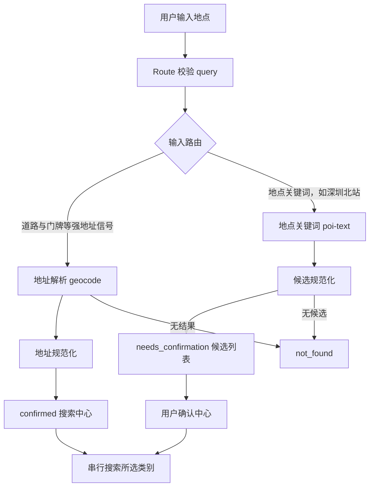
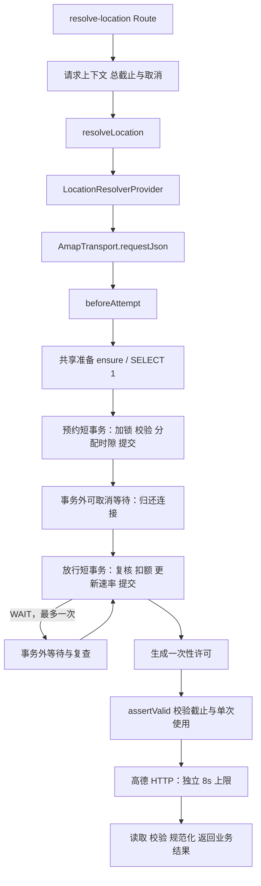

# 地点解析与准入链路调查

日期：2026-10-29（Asia/Shanghai）。首轮调查交付；改造建议进入后续 Stage A／B 设计，当前业务源码沿用入场状态。**Vercel Preview 的真实错误日志、Preview 数据库状态和本轮真实高德返回**作为故障定位依据；已完成的受控场景用于机制解释及回归。真实失败、迁移后的真实成功、故障注入分别记录。

## 1. 版本、环境与当前状态

地点解析新增了数据库准入依赖。输入路由、候选规范化和确认逻辑在最初接入准入时保持原样；失败可以发生在请求高德之前。已定位的 Preview 故障是预约函数缺失；迁移后，截图同输入的真实解析和一轮真实十类别搜索均成功。等待、复查和许可窗口的失败组合来自受控复现，另列为后续治理依据。

| 层次／版本 | 对应状态及证据 | 环境与解释 |
| --- | --- | --- |
| 原解析基线 `b849deb`（`fee4314^`） | 已有请求取消、地址／关键词分流；服务端解析工厂尚未注入准入 | Git 历史核对；本轮用当前解析代码加无准入传输还原行为 |
| 准入接入 `fee4314` | 两个服务端工厂同时注入 `beforeAttempt`，覆盖 `geocode`、`poi-text`、`nearby` | 解析也开始依赖数据库资源、绑定、预约、额度及许可 |
| 准入校正 `68830ba`／`fc1cc26` | 时区及连接等待修正，仍使用 Prisma 交互事务 | [2026-10-27 Preview 记录](2026-10-27-amap-preview-validation.md)属于当时版本 |
| 错误传播 `da80be6`，PR #25 合并 `31adccd` | 部分停止场景保留已完成类别；准入等待等错误仍会停止后续类别 | 当前错误分类和搜索调度的历史来源 |
| 数据库预热 `ed351da`，PR #28 合并 `5e94d44` | 启动／请求共享准备，准入短期限在准备后开始 | 历史只读 P2028 复现对应此阶段 |
| 短事务 PR #29 初版 `0c7689f` | PostgreSQL 两个函数、专用 `pg` 流水批次；初次 CI 通过 | 应用发布先于目标库函数迁移，曾出现 Preview 503 |
| PR #29 诊断补丁 `e9b1fba` | 跨 instrumentation／API 模块识别数据库错误，保留 SQLSTATE | 本轮核对的已部署 Preview；[PR #29](https://github.com/JKd121/nearby-places/pull/29)仍为 open |
| PR #29 最新远端 CI | [run 40719851763](https://github.com/JKd121/nearby-places/actions/runs/40719851763)：数据库集成 29／30，十类别延迟用例失败 | 断言实际模拟发送 3 次、预期 10 次；本地后续通过结果单列 |
| 当前工作区 | 分支 `Nearby-多类别真实数据探索-V1`，HEAD `7a629de`，包含未提交的预热、短事务、诊断及其他实验成果 | HEAD 与实际文件共同界定本轮源码；源文件哈希保存在调查证据目录 |
| 入场已有测试调整 | `test/admission-postgres.test.ts` 将十类别的“结果返回后延迟 300ms”调整为 TCP 上下行各 150ms，提取代理辅助函数 | 尚未提交；本轮保留该调整，调查未修改测试源码 |
| 本轮 Preview 迁移 | 北京时间 00:36，Prisma `migrate deploy --config prisma7.config.ts` 成功应用 `20261028000000_amap_admission_functions` | 沿用用户“仅迁移已核实 Preview”的授权；两条原资源、三条原绑定逐字段比对保持原样 |
| 本轮真实完整链路 | 北京时间 00:45 地点解析 200、10 个候选；00:46 十类别搜索 200、全部成功 | 相同已部署 `e9b1fba`＋Preview DB＋真实高德；搜索约 20.7s，共 11 次真实调用，搜索资源月计数增加 11 |

复核版本的方法：

```powershell
git rev-parse HEAD
git log --all --oneline -18
git diff fee4314^ fee4314 -- src/server/amap.ts src/location/resolver.ts src/location/provider.ts app/api/resolve-location/route.ts
```

最后一条比较仅显示两个工厂增加准入注入。原解析文件和 Route 在该提交中的差异为空。历史中“原解析正常”的用户观测，与新增前置条件导致请求提前终止的机制相符；每次实际故障仍按其阶段和错误证据归因。

### 1.1 Preview 身份与访问路径

- 项目 `nearby-places` 的 Preview `DATABASE_URL` 绑定 `nearby-preview`；production 绑定 `nearby-production`。Vercel 存储元数据的外部资源标识不同。
- 当前检查的部署为 `nearby-places-mf2z72pco-jk-d.vercel.app`，源码 `e9b1fba`。部署元数据 regions 为 `iad1`；历史诊断出现过 `hkg1`，本轮历史接口响应头为 `hkg1::iad1::…`。后续逐请求结合 trace／运行日志确认地域与网络段。
- Vercel CLI 下载当前 Sensitive 环境变量得到 `[SENSITIVE]`。随后找到已有、被 Git 忽略的 `.env.preview.local`，其注释标明用于 Preview 迁移。
- 对该旧连接先执行只读身份、迁移和能力检查，再与已部署 Preview 的 Prisma 历史读取比对：两条现存记录的内部 ID 一致，报告仅保存数量及哈希。结合当前环境绑定，确认该连接属于本轮 Preview 目标。
- 本轮执行两次已部署 `/api/history?limit=10` 读取：临时访客返回 HTTP 200、空列表；身份比对读取返回匹配记录。真实高德调用为 0。

当前有两条数据库路径，需要分别验证：历史记录使用 `PrismaClient → PrismaPg → PostgreSQL`；PR #29 准入使用 `PipelinedAdmissionDatabase → 专用 pg Pool → PostgreSQL`，普通历史客户端继续使用原配置。两者由 [数据库模块](../../src/db/prisma.ts) 装配。

### 1.2 本轮证据分层

| 证据层 | 本轮取得的结果 | 下一步所需证据 |
| --- | --- | --- |
| Vercel 已部署应用 → Prisma → Preview DB | 历史接口 200，身份比对成功 | 实例恢复时的连接行为 |
| Vercel 已部署应用 → 准入专用 pg → Preview DB → 真实高德 | 地点解析 200；一轮十类别全部成功；账本增量与 11 次调用吻合 | 按真实失败样本继续归因；强地址实测、冷／暖／恢复分段时序 |
| 已核实 Preview DB → 当前真实解析／准入代码 | 独立测试资源、实际函数及真实提交，模拟高德；详见第 4 节 | 将相同受控场景放到 Vercel 当前版本执行，记录生命周期与实际批次耗时 |
| 本地受控替身 | 原计划 9 场景重跑并持久化，补到 16 场景 | 用于顺序、传播、故障注入解释 |
| 独立临时 PostgreSQL 18.4 | 14 个分层场景，另执行既有 30 项集成测试 | 用于安全注入缺函数、断连、行锁及上下行延迟 |
| 真实高德 | 本轮解析 1 次＋十类别 10 次，共 11 次 | 后续按定位需要有界采集，保持真实请求、错误与账本关联 |

本地进程连接 Preview DB 的网络路径与 Vercel 函数执行路径分别记录。当前故障结论以实际 Preview 请求、数据库状态和运行日志为依据；注入场景用于解释已知机制。

## 2. 两条链路还原

### 2.1 输入到候选结果：业务链路



本轮固定输入为“深圳北站”和“深圳市福田区深南大道1001号”，响应为固定合成地点。关键词分支返回候选供确认；强地址分支返回 `confirmed`。这里的“预热／准备”处理数据库连接就绪，候选数据整理位于高德响应之后。

### 2.2 内部调用：新增保护位于 HTTP 发送前



旧链路在传输层直接进入 HTTP；当前链路先执行准入。预约成功只推进 `nextReservationAt`；放行成功才共同提交日／月扣额、消费水位与 `nextGrantAt`。收到完整批次和明确 `COMMIT` 后，应用继续生成许可；使用许可时再次检查取消和期限。

代码入口：[Route](../../app/api/resolve-location/route.ts)、[解析](../../src/location/resolver.ts)、[Provider](../../src/location/provider.ts)、[Transport](../../src/amap/transport.ts)、[准备](../../src/admission/prepare.ts)、[准入编排](../../src/admission/service.ts)、[流水执行器](../../src/admission/database.ts)、[数据库函数](../../prisma/migrations/20261028000000_amap_admission_functions/migration.sql)。

## 3. 新增前置条件、责任与时间关系

### 3.1 前置条件清单

| 前置条件 | 谁检查／何时检查 | 失败表现与影响 |
| --- | --- | --- |
| 准入池物理连接、共享准备 | `createDatabaseReadiness`／`withAdmissionPreparation`，进入短准入前 | 准备失败映射 `ADMISSION_UNAVAILABLE`；父取消／总截止继续传播；当前解析无候选返回 |
| 函数及签名存在 | 预约／放行 SELECT 实际调用时；当前预热只执行 `SELECT 1` | 缺函数 SQLSTATE `42883`，本轮迁移前已从目标库只读确认两个函数均缺失 |
| schema、函数与表权限 | PostgreSQL 在执行各 SQL 时检查；函数为调用者权限 | 权限故障通常有 `42501`；目标库迁移后已确认当前连接角色具备两个函数 EXECUTE，部署运行角色仍应纳入验收 |
| 资源存在、启用、操作绑定正确 | 两函数先锁资源，再锁／复核绑定 | 返回 `ADMISSION_UNAVAILABLE`；覆盖解析的 geocode 与 poi-text |
| 策略版本一致 | 预约返回版本，放行复核 | 策略修改使旧预约失效，停止该次发送 |
| 预约容量与时间窗 | reserve 以锁后数据库时间分配，grant 与应用再复核 | `ADMISSION_WAIT_EXCEEDED`；可能早于 2 秒总准入结束 |
| 尚未重复消费、最终放行间隔满足 | grant 检查消费水位和 `nextGrantAt` | 重复消费拒绝；尚未到最终放行时间可能返回 `WAIT` |
| 上海日／月额度充足 | grant 锁内按上海周期检查与扣减 | `DAILY_BUDGET_EXHAUSTED`／`MONTHLY_BUDGET_EXHAUSTED`；共享同资源的操作受到影响 |
| 所有批次排空、明确提交确认 | `PipelinedAdmissionDatabase` | 确认丢失时停止发送、销毁异常连接；数据库可能已扣额 |
| 一次性许可仍有效 | Transport 真正调用 fetch 之前 | 许可过期或复用被拒绝；已提交额度保留 |

### 3.2 时间来源与预算

| 时间项 | 当前策略／时钟 | 管理责任 |
| --- | --- | --- |
| Web 总期限 | 默认 60s，`performance.now()` | Route 在正文读取前建立上下文；取消贯穿后续操作 |
| 共享准备 | 10s 截止、10s 新鲜期、失败冷却 1s；新鲜期用 `Date.now()` | 准入池实例级协调；取消一个等待者后，共享探测继续服务其他等待者 |
| 物理建连 | 8s | 专用 pg 池；归于准备或连接恢复 |
| 一次准入 | `min(2000ms, 父请求剩余时间)` | 准入编排，准备完成后开始 |
| 每批次连接获取 | `min(600ms, 当前剩余)` | 执行器；取消／获取超时后回收迟到连接 |
| SQL／锁／空闲事务 | SQL 与空闲事务最多 800ms，锁最多 150ms；按当前剩余缩短 | 每个事务内 `set_config(..., true)`；SQL 限时约束语句执行 |
| 驱动读取 | `min(1200ms, 派发时剩余)` | 驱动保护整个已发送查询的读取；结果继续排空，异常连接销毁 |
| 预约 | wait 最多 2000ms、grace 800ms、interval 800ms | 数据库锁后 `clock_timestamp()`；跨边界用 epoch 毫秒 |
| 许可 | 最多 400ms，且受预约及总准入截止约束 | 数据库返回时长，应用从 grant 调用开始保守计时 |
| 高德 HTTP | 默认 8s，并受父期限约束 | 准入之后才建立单次 HTTP 上下文 |
| 类别间等待 | 固定 500ms，十类别有 9 次计划等待 | 当前串行搜索服务；准入另行控制共享资源速率 |

令 `D` 为短准入截止，`r0/r1` 为预约调用开始／接收时刻，`Vr/Dr` 为函数返回的有效时长／等待时长，`g0` 为最终 grant 开始，`Vg` 为许可时长。当前应用实际使用：

```text
ticketEnd = min(D, r0 + Vr)
预约返回后仍等待完整 Dr
grant 的可用预算 = min(D - now, ticketEnd - now)
首次 grant 返回 WAIT 后，再等待完整 delayMs，最多复查一次
permitEnd = min(D, ticketEnd, g0 + Vg)
发送条件：未取消、未使用、now < permitEnd
```

`Vr/Dr/Vg` 的采样来自数据库，应用又从调用开始保守扣除整个往返。这个算法保留了提前失效保护，同时可能缩短可用窗口；返回途中已经经过的时间与收到结果后的完整等待需要联合分析。直接减去整个 RTT 会引入提前到达风险，改造需明确时钟采样点、上／下行不确定性和锁内最终复核。

## 4. 逐步接入实验记录

本地原始记录目录：`.local/poi-union-v1/admission-chain-investigation-20261029/`，受 `.gitignore` 保护。只保存脱敏结果到交付文档；连接、访客标识及原账本快照留在本地私有文件。替身实验的耗时仅用于顺序解释。

### 4.1 Preview 真实请求：当前故障定位的主要证据

已部署版本固定为 `e9b1fba`，未重新发布应用。函数迁移前的实际 Preview reserve 日志为 SQLSTATE `42883`；本轮只读能力检查同时确认两个函数均缺失。00:36 迁移完成后，通过 Vercel CLI 的已认证访问执行真实请求，无应用内重试、翻页或并发搜索。

| 编号／北京时间 | 真实输入及路径 | 实际返回 | 账本及解释 |
| --- | --- | --- | --- |
| R01，00:45 | `POST /api/resolve-location`，query=深圳北站 | HTTP 200，`needs_confirmation`，真实候选 10 个；curl HTTP 时间 2.704894s | `amap-search` 月计数＋1；LBS 无变化；请求 ID `hkg1::iad1::b72wh-1793205916792-b291b95f2735` |
| R02，00:46 | 从 R01 返回中选取同名火车站作为**本次测试中心**，3km、全部十类别，`POST /api/search` | HTTP 200，`success`，十类全部成功；curl HTTP 时间 20.694634s | 搜索资源日／月各＋10；LBS 无变化；请求 ID `hkg1::iad1::knjjr-1793205990398-1b219de442aa` |

R02 的逐类别条目数：酒店 25、商场 25、火锅 25、面包 25、甜品 25、KTV 13、台球 25、健身房 25、公交 25、地铁 4。它们是本次响应条目数，分页及业务过滤沿用现状。测试选择中心用于复现后续搜索，产品中仍由用户确认候选。

只读观察捕获了 R02 十次连续的已提交计数。按已提交 `nextGrantAt - 800ms` 还原数据库放行采样时刻，相邻间隔为 2261、1519、2824、1583、1497、1486、2772、2927、2174ms。本轮观测的最小间隔 1486ms；这是数据库放行时间序列，HTTP 实际发送时间仍需传输层观测。

R01 跨上海日周期：原搜索资源保留 `2026-10-28 / dayUsed=11`，本次 grant 惰性切换到 `2026-10-29 / dayUsed=1`；月计数＋1。因此逐次扣额使用周期及计数共同核对。R02 位于同一日，日／月增量均为 10。

本轮实际高德调用合计 11 次。随后读取部署运行日志，允许的失败前缀未返回新失败记录；HTTP 返回、候选／类别结果和账本增量作为本次成功依据。原始真实响应与观察快照存于本地 `.private.json`，交付只保留脱敏摘要：`preview-live-resolve-result.json`、`preview-live-search-result.json`、`preview-live-grant-timeline.json`。

这个前后对照支持：此前已捕获的 Preview 函数缺失故障得到修复，当前同版本真实链路完成解析和十类别搜索。20.7s 的搜索总时间仍需按数据库、上游、固定等待细分；受控复现中的时间窗口问题单独保留。

### 4.2 Preview 数据库：已定位机制的受控复现

Q 系列使用 UUID 命名的独立资源／credential 绑定，沿用 800／2000／800／400ms 策略；高德响应固定注入，这组真实高德调用为 0。每轮结束仅删除该轮创建的绑定与资源，随后比对原有账本。

> 执行环境：下列解析／准入编排运行于 Windows 客户端，连接已核实 Preview PostgreSQL。Vercel 当前部署上的 Prisma 读取已另行执行；Vercel 当前版本的模拟高德完整链路列入第 6 节验收。

| 编号 | 接入／输入 | 实际结果 | 预算与连接、计数 |
| --- | --- | --- | --- |
| Q01 | 冷准备＋完整关键词解析 | `needs_confirmation` | 准备 1916.99ms；预约／放行批次 292.73／284.92ms；模拟 HTTP 1、独立资源扣额 1；两批 COMMIT 确认 |
| Q02 | 冷准备＋完整强地址解析 | `confirmed` | 准备 1898.39ms；两批 282.94／276.39ms；模拟 HTTP 1、扣额 1 |
| Q03 | 预约收到后 20ms 取消 | `REQUEST_CANCELLED`；观测到取消发生在已派发 grant 期间 | 预约返回 delay=0；grant 仍完成提交，模拟 HTTP 0、扣额 1；用于解释派发后的取消竞态 |
| Q04 | 放行结果额外延迟 450ms | `ADMISSION_WAIT_EXCEEDED` | 放行批次 286.27ms、已 COMMIT；模拟 HTTP 0、扣额 1 |
| Q05 | 准备后设置未来时隙，真正等待中取消 | `REQUEST_CANCELLED` | 预约返回 delay=905ms，未派发 grant；模拟 HTTP 0、扣额 0 |
| Q06 | 十类别串行完整搜索 | `success`，十类 empty（固定空响应） | 模拟 HTTP 10、独立资源扣额 10；20 批次均确认 COMMIT，批次约 273–292ms |
| Q07 | 首类真实准入成功；第二类注入一次 `ADMISSION_WAIT_EXCEEDED` | `partial success`，后八类 skipped | 模拟 HTTP 1、扣额 1；证明当前调度如何传播局部准入失败，第二类错误为受控注入 |
| Q08 | 独立资源日额度设为 1 | 第二类真实函数返回 `DAILY_BUDGET_EXHAUSTED`，部分结果、八类 skipped | 模拟 HTTP 1、扣额 1；共享额度停止路径 |
| Q09 | 先准备，再建立 900ms 父期限 | 首类完成后在类别等待期间 `REQUEST_DEADLINE_EXCEEDED`，未交付 SearchResponse | 模拟 HTTP 1、扣额 1；用于复现整体截止的结果传播 |

Q03 原始首轮用例名为 `Q03-cancel-wait`，实际时序显示冷准备已消耗所设的未来预约时间，返回 delay=0。这里按观测记录为“放行期间取消”；真正等待中取消另用 Q05 验证。固定未来时间必须在准备完成后设置，避免测试前置步骤耗尽窗口。

两轮 Q 系列共创建 9 条独立资源、27 条绑定，均已精确清理；原有资源和绑定在各轮前后哈希一致，测试资源剩余 0。这个比对发生在 R01／R02 真实调用之前；真实调用的业务账本增量另按上节记录。结果见 `preview-database-results.json`、`preview-extensions-results.json`。

### 4.3 原计划 9 个替身场景：重新运行并保存

这些场景使用真实 resolver、provider、transport、准入编排和固定协议解析；数据库与高德均为受控替身。M07 使用真实流水执行器加模拟连接，函数调用抛出 `42883`，批次最终收到 `ROLLBACK`。

| 编号 | 唯一改变的接入因素 | 预期与实际结果 | 模拟扣额／模拟 HTTP | 关键顺序与状态 |
| --- | --- | --- | --- | --- |
| M01 | 原解析行为，无准入 | 候选 | 0／1 | HTTP → 规范化 |
| M02 | 仅准备 | 候选 | 0／1 | prepare → HTTP |
| M03 | 预约＋放行 | 候选 | 1／1 | prepare → reserve → grant → HTTP |
| M04 | 预约返回 delay=25ms | 等待后候选 | 1／1 | 等待阶段无数据库连接 |
| M05 | 首次 grant 返回 WAIT=20ms | 一次复查后候选 | 1／1 | grant → 等待 → grant → HTTP |
| M06 | 准备失败 | `ADMISSION_UNAVAILABLE` | 0／0 | 停在 prepare |
| M07 | 函数缺失 | `ADMISSION_UNAVAILABLE`，底层 `42883` | 0／0 | BEGIN → 配置 → 函数失败 → ROLLBACK → 健康归还 |
| M08 | 预约有效期 30ms、返回延迟 45ms | `ADMISSION_WAIT_EXCEEDED` | 0／0 | reserve 后终止，未 grant |
| M09 | grant 返回延迟 450ms、许可 400ms | `ADMISSION_WAIT_EXCEEDED` | 1／0 | 已模拟提交，许可使用前终止 |

补充 M10–M16：强地址基线／完整接入均 `confirmed`；等待时取消为 `REQUEST_CANCELLED`、0／0；准备中父截止为 `REQUEST_DEADLINE_EXCEEDED`、0／0；返回 delay=80ms、返回延迟约 40ms 时仍在接收后等待完整 80ms；取消一个共享准备等待者后另一等待者成功、探测总共 1 次；两次准入不可用分别触发准备失效，两次请求探测共 2 次。

原始结果：`progressive-results.json`；可复跑脚本：`progressive.mjs`。这组实验真实数据库、高德调用均为 0。

### 4.4 临时 PostgreSQL：解释机制的分层实验

PostgreSQL 18.4，loopback `127.0.0.1:55440`，单独新建 `nearby_admission_test_investigation_20261029_*` 数据库。加载实际两份迁移；审计触发器只存在于临时库。固定资源策略 interval=800、wait=2000、grace=800、permit=400ms。

| 编号 | 场景与结果 | 扣额／模拟 HTTP | 观测 |
| --- | --- | --- | --- |
| P01 | SELECT 1 成功，函数未安装 → `ADMISSION_UNAVAILABLE`／42883 | 0／0 | ROLLBACK 排空，随后 SELECT 1 可复用连接 |
| P02 | 函数已装，绑定缺失 → `ADMISSION_UNAVAILABLE` | 0／0 | 业务拒绝结果所在短事务 COMMIT 已确认 |
| P03／P04 | 完整关键词／强地址 | 各 1／1 | 候选／confirmed；两批次后活动连接数 0 |
| P05 | 预约等待中取消 → `REQUEST_CANCELLED` | 0／0 | 连接已归还，独立连接 `FOR UPDATE NOWAIT` 成功；预约尾部仍保留 |
| P06 | 已提交 grant，结果再延迟 450ms → 许可失效 | 1／0 | 保守消耗 |
| P07 | 实际提交后，夹具丢弃 COMMIT 确认 → `ADMISSION_UNAVAILABLE` | 1／0 | 执行器记录 committed=false，连接销毁；数据库计数证实已提交 |
| P08 | 注入 80ms 最终放行屏障 | 1／1 | 一次 grant WAIT，再复查成功，共三批 |
| P09 | TCP 上／下行各 150ms | 1／1 | 两批 311.02／320.01ms |
| P10／P11 | TCP 仅下行／仅上行 300ms | 各 1／1 | 两批分别 324.54／327.83ms、326.41／327.46ms；单次样本 |
| P12 | 准备后设置未来预约＋300ms RTT | 1／1 | reserve 返回 delay=435ms；收到后继续等约 437ms；grant 审计时刻比预约约晚 325ms |
| P13 | 300ms RTT，预约后注入未来最终放行屏障 | 0／0 | 首次 grant 返回 WAIT=348ms；第二次 grant 前预约本地窗口耗尽，`ADMISSION_WAIT_EXCEEDED` |
| P14 | TCP 上下行各 100ms，grant 写入前服务端睡眠 250ms | 1／0 | grant 批次 482.07ms，COMMIT 已确认；400ms 许可使用前失效 |

P13 的屏障由独立控制连接在预约返回后写入，用于重现“预约时隙与最终速率屏障分离”的状态。控制写入和观测本身的耗时也消耗测试时序，结果按该受控场景解释。

P14 首次探索曾使用 300ms RTT＋150ms 服务端延迟，遇到 grant 剩余读取预算约 472ms、实际批次约 479ms，返回 `ADMISSION_UNAVAILABLE`，该轮断言失败。随后用更宽的预约剩余量分离“读取超时”与“许可失效”，得到上表场景。临界抖动如何影响错误归类仍列为待查项，失败观测保留在调查过程说明中。

原始记录：`postgres-results.json`、`postgres-run.txt`。记录客户端 `performance.now()` 偏移、客户端墙钟基准、数据库审计 epoch 时间、每批诊断、提交状态和 TCP 分方向延迟。上／下行代理按数据块延迟；两种时钟同属本机，远端场景另需记录时钟偏差和采样不确定性。

### 4.5 既有回归与 CI 差异

- 本轮入场源码执行 `npm test`：252 项核心／Route／实验测试＋19 项 AST，共 271 项通过。
- 当前未提交 TCP 测试版本执行 `npm run test:admission:postgres`：30 项通过，临时 PostgreSQL 18.4，约 22.8s。该入口会重建测试表和函数，仅用于专门的一次性库。
- 最新 PR `e9b1fba` 的远端 CI（PostgreSQL 17.11）数据库集成 29／30。失败是十类别模拟发送 3／10；最后失败 grant 的预算约 93ms、返回时剩余约 87ms，COMMIT 确认、`ADMISSION_WAIT_EXCEEDED`。
- 远端用例是在真实批次返回后额外等待 300ms，本地未提交版本改为 TCP 双向延迟。两者模拟的时间分布不同，远端失败原因仍需以同源码、同模型及 Preview 复现解释。
- 本轮业务源码无修改；类型检查／生产构建沿用各交付记录中的版本结果，本次未重新执行 `check/build`。

## 5. 根因与待验证假设

### 5.1 已确认故障、机制与改造出口

F2 对应此次 Preview 503 的实际定位与修复；F3 对应此前另一版本的真实 P2028。F4–F8 由源码及受控场景确认其行为，作为后续时间治理／调度设计依据；本轮 R01／R02 实际请求均成功。

| 编号 | 证据与重现 | 当前解释 | 最小改造建议／回归 |
| --- | --- | --- | --- |
| F1 新依赖改变了解析可用条件 | `fee4314` 工厂差异；M01–M09、Preview Q01／Q02 | 同样的解析输入会在高德之前被数据库保护拒绝 | 在准备、预约、等待、放行、许可使用分别标记阶段及原因；分别覆盖地址与关键词；Stage A |
| F2 Preview 应用先于函数迁移 | 实际 Preview reserve `42883`；目标库两个函数缺失；迁移后真实 R01／R02 成功；P01 故障复现 | 预热连通后仍缺必要数据库能力，直接产生 503；本轮已修复该部署前置问题 | 发布前 capability 检查＋迁移顺序；原账本已核对；Stage A／发布前置 |
| F3 旧多往返事务耗尽预算 | 历史只读复现：配置／资源／绑定约 294／305／297ms，800ms 事务预算后在 clock 标签发生 P2028 | 错误发生于时钟 SQL 发送前；原预约写入与 grant 未执行 | 已有短事务方案减少串行往返；保留故障阶段诊断，用 Preview 完整时间轴验证 |
| F4 返回等待与保守截止叠加 | M14、P12、P13；第 3.2 节公式 | 时间从多个采样点计算，复查可在总期限尚有余量时遇到预约截止 | 统一时间上下文、明确相对时长基准、等待前检查下一批可行性；保留最终锁内保护；Stage A |
| F5 提交成功后许可仍可能失效 | M09、P06／P14、Preview Q04 | 额度提交与实际发送之间存在许可检查；耗时组合可能留下已扣额且未发送 | 诊断区分 committed 与 sent，发送前估算／测量许可余量；先测 Preview 再设计窗口参数；Stage A |
| F6 准备失效过于笼统 | M16；当前 `ADMISSION_UNAVAILABLE` 一律 invalidate，SELECT 1 本身成功 | 缺函数／绑定等配置故障会重复做连通准备；探测成功路径也未进入失败冷却 | 区分连接健康、能力就绪、资源配置，按原因失效和冷却；Stage A |
| F7 局部准入等待会停掉剩余类别 | 当前 classifier 与搜索 switch；Preview Q07 | 错误分类直接给出 stop，调度器跳过后续类别 | 错误性质＋影响范围分开，调度器结合总期限和资源范围决定继续；Stage B |
| F8 总截止与部分结果返回需协调 | `withRequestLifecycle` 在返回前复查取消，搜索遇父截止向上抛出；Preview Q09 | 硬截止后既有结果返回路径被终止 | 提前结束工作并预留响应时间，定义截止部分结果协议；Stage A 时间机制＋Stage B 调度 |

历史 P2028 记录：[准入预热交付](2026-10-28-admission-database-warmup.md)、[短事务交付](2026-10-28-admission-functions.md)，原始单次复现 `.local/poi-union-v1/admission-reproduction-once.json`。本轮未重跑旧远程事务。

### 5.2 预约放弃的实际语义

当前数据库账本使用预约尾部和已消费水位，未为每个 ticket 建独立状态记录，也未实现 cancel-reservation 函数。应用放弃预约时结束后续等待／放行；已推进的 `nextReservationAt` 留下一个空时隙。P05 验证了“连接和行锁释放、未扣额、尾部保留”；Preview 的等待取消与派发后取消分别记录。

保留时隙有利于维持后继预约的顺序，但取消密集时可能降低短期可预约容量。回收设计必须处理后继预约、跨进程、防重和策略变化。可选出口是接受有界空洞并增加可观测性，或在证实实际容量损失后设计可识别预约的回收机制。直接回退共享尾部涉及后继预约安全，应先有相应竞争测试。

### 5.3 尚待 Preview 解释的假设

1. 当前部署地区、数据库服务路径、连接恢复会把正常批次推到什么区间？采集 prepare、acquire、batch、数据库执行与返回时间，覆盖冷／暖／恢复。
2. 800ms grace、400ms permit、一次复查及驱动剩余预算，是否给实际 Preview 时延留下足够余量？本轮已有成功与失败组合，尚需同版本分布及抖动样本。
3. 取消或失联密集时，预约空洞会产生多少额外拒绝？用独立 Preview 测试资源、两个执行进程和有界请求量验证。
4. 本轮迁移后 R01／R02 已真实成功；后续若再出现解析失败，是否来自相同时间关系？优先捕获实际失败请求的阶段和时序，定位后再使用模拟上游做稳定回归。
5. CI 的十类别失败与本地时间模型、PostgreSQL 版本、运行器调度各有什么关系？保留原失败模型，补齐每个类别的预约／放行时序，避免只替换测试模型后结束调查。

## 6. 后续逐步接入、改造依据与验收

### 6.1 以 Preview 为主的调查顺序

首先在实际 Preview＋真实高德链路固定输入采集，保存请求／响应／日志及账本对应关系。识别失败阶段后，再固定已捕获的响应或故障，每轮只改变一个接入因素。每条结果写明 commit／本地哈希、Vercel deployment、数据库身份指纹、操作、阶段和影响范围。

1. **还原基线**：地址与关键词各一例，复用当前解析／传输；记录候选或 confirmed。
2. **接入准备**：Preview 的 Prisma 与专用 pg 分别探测；检查函数签名、EXECUTE、表权限及绑定。测试共享等待、一个父请求取消、失败冷却和实例恢复。
3. **接入预约**：独立资源／credential，记录锁后数据库时间、scheduled／expires、返回等待、调用往返、池占用；同时保存原业务资源快照摘要。
4. **接入等待**：在准备完成后设置未来时隙；验证取消发生在真正等待期间；对照放弃前后尾部、额度、行锁与连接状态。
5. **接入放行和许可**：原子扣额、防重、策略／绑定变化、一次 WAIT 复查、提交确认丢失、许可临界耗时。危险故障注入先在一次性库解释，再选择可隔离方式在 Preview 验证。
6. **恢复完整业务**：R01／R02 已完成当前 Vercel 版本的真实关键词解析和一轮真实十类别串行搜索。继续需要时先追踪真实失败，之后针对局部失败、连续失败、资源额度耗尽、全局故障和整体截止做受控回归。

Preview 验证夹具只创建带随机任务标识的资源和绑定，清理按明确 ID 执行。现有 `test:admission:postgres` 包含 DROP／TRUNCATE 初始化，继续使用一次性测试库；Preview 使用本轮按行隔离的验证方式。

既有临时 Vercel 验证项目 `nearby-admission-check-20261027` 使用旧版 Prisma 交互事务和 `primary` 绑定，适用于历史解释。本轮未调用其测试入口；后续当前版本验收优先复用主项目 Preview 的设施，测试资源独立命名。

### 6.2 Stage A：统一时间机制

| 改造候选 | 直接依据 | 验收重点 |
| --- | --- | --- |
| 扩展 `request-context.ts` 统一子期限、剩余预算、等待与原因 | F4／F8；准备使用墙钟、准入另算单调时钟 | 同一时间轴可追踪父期限／预约／许可；取消向下传播；准备等待者互不误取消 |
| 梳理等待基准与复查派发条件 | M14、P12／P13 | 等待有明确采样点，复查前能够判断剩余窗口；数据库最终放行间隔仍满足 |
| 删除 Web 类别固定 500ms 等待 | 当前十类别 9 次固定等待；数据库已负责共享间隔 | Preview 比较删除前后总耗时、批次、实际 grant 间隔及扣额；串行结构保留 |
| 按 Preview 分阶段实测再设计预算 | Q01／Q02 冷准备约 1.9s，批次约 0.28–0.29s；P14、Q04 许可失效 | 连接、SQL、等待、响应、许可各自有依据；总期限覆盖完整操作与响应整理 |
| 分离连接健康与能力／资源配置故障 | F2／F6 | SELECT 1 成功后能定位缺函数、权限、绑定；配置故障使用合适冷却 |
| 增加脱敏时序与失效点 | 当前失败日志已有 phase、SQLSTATE、committed，许可使用点信息较少 | 补充 reserve/grant 调用边界、等待计划／实耗、ticket／permit 剩余和 sent 标志，保留字段白名单 |

`searchCategoriesSequentially` 同时被 [CLI smoke](../../src/amap/smoke.ts) 使用，删除 Web 固定等待时一并核查 CLI 的独立节奏和保护来源。保留 60s 总截止、单次 HTTP 上限及必要数据库保护，参数是否调整依据 Preview 结果确定。

### 6.3 Stage B：性质与影响范围分离

| 场景 | 调度方向 | 回归 |
| --- | --- | --- |
| 地点解析准入失败、中心尚未确认 | 返回解析阶段受控错误，保留用户输入与重试入口 | 地址／关键词均覆盖；验证高德发送数 |
| 某类别一次准入等待超限，总预算充足 | 记录该类别失败，再由调度器判断下一类别的可行性 | Q07 对照；首类失败、已有结果、连续失败分别覆盖 |
| 资源日／月额度耗尽 | 对同一资源的后续操作停止，保留可用结果 | Q08 对照；区分 search 与 geocode 资源映射 |
| 缺函数／权限或共享数据库整体故障 | 对依赖该故障范围的操作停止，避免逐类别重复探测 | 配置故障、短暂获取超时、整体断连分别覆盖 |
| 整体工作期限将尽 | 停止新工作，按已定义响应协议交付已完成结果 | Q09 对照；预留响应时间，保留用户主动取消语义 |

内部错误建议提供性质、阶段、资源影响范围、提交确认／结果不确定信息。调度器拥有“继续／跳过同资源／终止”的决策权。公开 API 可继续使用现有安全错误码；如新增部分截止结果、结构化失败范围或终止原因，应同步 contracts、Route、UI 与历史保存规则，单独设计兼容性。

### 6.4 验收清单与发布状态

- [x] 原解析与新增准入的 Git 差异还原，地址／关键词基线覆盖。
- [x] 原计划 9 场景重跑，补充共享准备、取消与等待基准证据。
- [x] 当前 Vercel Preview 的 Prisma 读取、目标数据库身份比对。
- [x] 核实 Preview 函数缺失，按已有授权应用函数迁移，确认执行权限和原资源／绑定保持原样。
- [x] Vercel 当前版本＋Preview DB＋真实高德：截图同输入解析成功，一轮十类别全部成功，记录请求 ID 与 11 次调用的账本变化。
- [x] 临时库分层实验及现有回归运行，保留远端 CI 失败记录。
- [x] Preview 数据库的独立资源回归：等待取消、派发后取消、许可过期、十类别、局部失败、额度耗尽及整体截止；测试行精确清理。
- [ ] 当前 Vercel 版本的已定位故障回归及真实强地址解析；按后续具体故障选择模拟注入方式。
- [ ] 同部署冷启动、暖连接、实例恢复、父取消与提交不确定的阶段时序。
- [ ] Preview 的 Stage A 参数／等待算法对照及 Stage B 调度回归。
- [ ] 据调查结论细化 A／B 实施差异；公开协议变化同步相关模块。

迁移是本轮独立发布前置事项，执行时间和授权已在第 1 节补记。本轮真实请求直接使用现有 Preview 部署；后续应用发布和回归按实际版本继续记录，回滚应用时保留新增函数与账本。

## 7. 复现资料与交接

本地目录包含：`entry-hashes.json`、原 `PLANS.before.md`、`progressive.mjs`／`progressive-results.json`、`postgres.mjs`／`postgres-results.json`、`preview-database.mjs` 及两轮 Preview 结果、`preview-live-resolve.mjs`／`preview-live-search.mjs` 及真实结果摘要、Prisma 迁移脱敏输出、回归日志。`.private.json` 和 `.env` 文件只作本地敏感材料，分享调查时仅携带脱敏报告。

从仓库根目录可复跑纯替身实验：

```powershell
node --conditions=react-server --import tsx .local/poi-union-v1/admission-chain-investigation-20261029/progressive.mjs
```

实际 Preview 重现可使用已安装 Vercel CLI、相同部署 URL 和固定输入。先保存原账本的周期／计数／水位，再执行下列单次请求，随后立即读取账本并按请求 ID 查运行日志。此命令会触发真实准入及高德调用，按明确测试范围执行：

```powershell
$cli = 'C:/Users/lenovo/AppData/Local/npm-cache/_npx/69f9afb961c37556/node_modules/vercel/dist/index.js'
$payloadPath = Join-Path $PWD '.local/poi-union-v1/admission-chain-investigation-20261029/resolve-once.json'
[IO.File]::WriteAllText($payloadPath, '{"query":"深圳北站"}', [Text.UTF8Encoding]::new($false))
node $cli curl /api/resolve-location --deployment nearby-places-mf2z72pco-jk-d.vercel.app --scope jk-d -- --request POST --header 'Content-Type: application/json' --data-binary "@$payloadPath"
node $cli logs runtime --deployment dpl_6W6XzLTpnZzrsgGEdeXN7BD5y3WK --project nearby-places --scope jk-d --limit 30 --json
```

只读能力检查可在已核实的 Preview 连接上独立执行：

```sql
SELECT
  to_regprocedure('public.amap_admission_reserve_v1(text,text,integer)') AS reserve,
  to_regprocedure('public.amap_admission_grant_v1(text,text,text,integer,bigint,bigint,integer)') AS grant;
SELECT id, day, month, "dayUsed", "monthUsed", "nextReservationAt",
       "consumedReservationAt", "nextGrantAt" FROM public."AmapResource" ORDER BY id;
```

十类别复现沿用 R01 返回的同名车站坐标构造 `center` 与 `resolvedLocation`，半径 3000、类别按 hotel／mall／hotpot／bakery／dessert／ktv／billiards／gym／bus／subway 排列，调用 `/api/search`；按 `parseConfirmedSearchRequest` 校验请求结构。真实响应、私有请求体及实时账本观察已保存在本地调查目录，可直接检查本次对应请求。

临时库脚本固定校验 loopback、端口及任务数据目录后新建独立数据库；Preview 脚本要求已有目标身份验证记录，使用独立 UUID 行且 finally 精确清理。脚本属于本地调查材料；接手者也可按第 4 节矩阵，在已有准入测试设施中构造同协议与同故障。

后续新增结果至少包含：输入／固定响应、版本与部署、数据库目标指纹、接入阶段、预期／实际、公开错误与 SQLSTATE、父／预约／许可剩余、连接获取／批次／等待耗时、COMMIT 确认、扣额增量、模拟 HTTP 次数、连接归还／销毁及测试行清理结果。时间记录明确客户端单调时钟、数据库采样点和网络分段；对跨主机样本保留偏差范围。

交付检查：入场 238 个文件中，新增入口的 `PLANS.md` 之外，237 个文件字节哈希保持一致；原 PLANS 正文字节完整保留。本轮新增本调查文档；11 个相关源码／迁移文件与 PR `e9b1fba` 内容一致（忽略换行差异）。文档本地链接与代码围栏检查通过，暂存区为空。脱敏核对结果保存在 `final-audit.json`。
