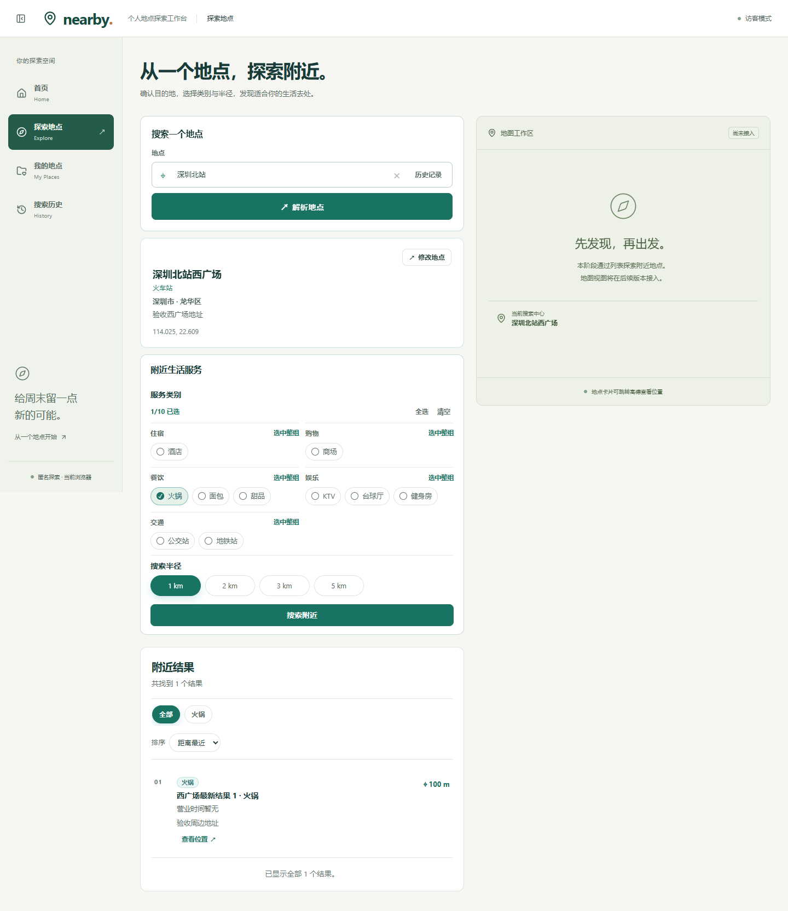
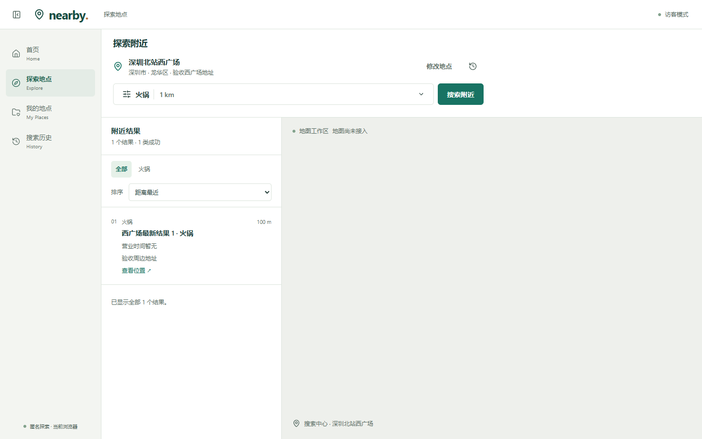
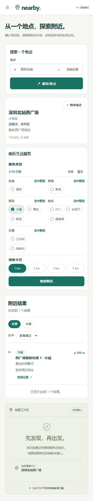
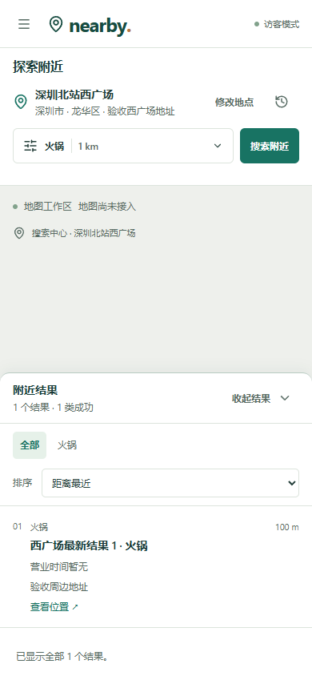
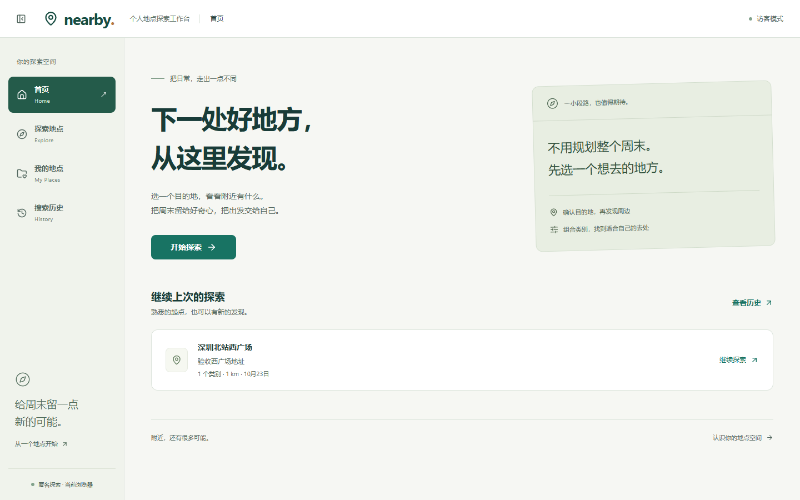
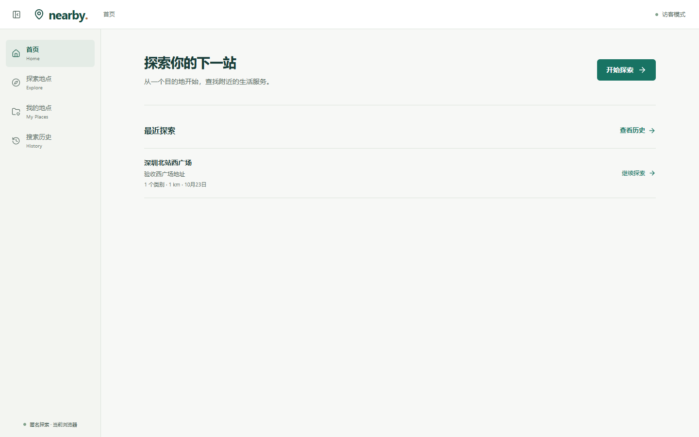

# Issue #7 — actual browser comparisons

Captured from the production-built UI in Windows Chrome at 1440×900, 390×844 and 820×1180. `before/` is entry commit `c66dfdcd2dafd43d768b9867adaa6bdc7550e596`; `after/` is the reviewed Issue #7 implementation. Full-page screenshots retain the viewport width; a tall before file is the old document height, not a different viewport. Fixtures are synthetic AMap results and an isolated in-memory database boundary, not live-service evidence.

| Surface and matching state | Before | After |
| --- | --- | --- |
| Explore desktop, one hotpot result, 1 km |  |  |
| Explore phone, same center/categories/radius |  |  |
| Home desktop, one saved search |  |  |

18 baseline PNGs and 25 final PNGs also cover all four routes, phone/tablet/desktop empty states, populated Home/History, long candidate names, condition editing and collapsed phone results. Candidate/condition screenshots are intentionally scrolled within bounded dialogs; their internal content remains scrollable while header/footer controls stay fixed.

Reproduce after `npm test`, `npm run check` and `npm run build` with `npm run test:browser`. Requires local Chrome and free ports 3187/3188; no real provider/database or environment file. `BROWSER_EVIDENCE_DIR` overrides the default `after/` destination. See the root README for localhost process placeholders needed during a clean install/build.

- [Executed browser report summary](browser-summary.json): extracted from the final Playwright HTML report; 14 expected, 0 unexpected/flaky/skipped.
- [Verification and screenshot/source hashes](verification.json).
- [Scope, review and exact limitations](../2026-10-23-issue-7-explore.md).

Independent review opened the required before/after files and requested one resolver concurrency correction. Its final limited verdict scored that fix resolved and confirmed the auxiliary contrast correction (`ship` for those corrections). It does not constitute product-owner approval, live PostgreSQL/AMap testing, physical-device testing or production authorization.
