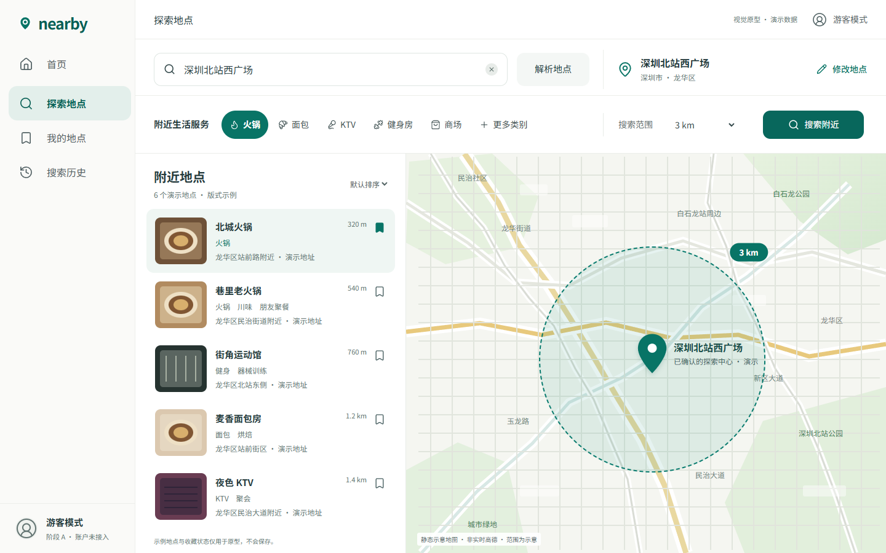
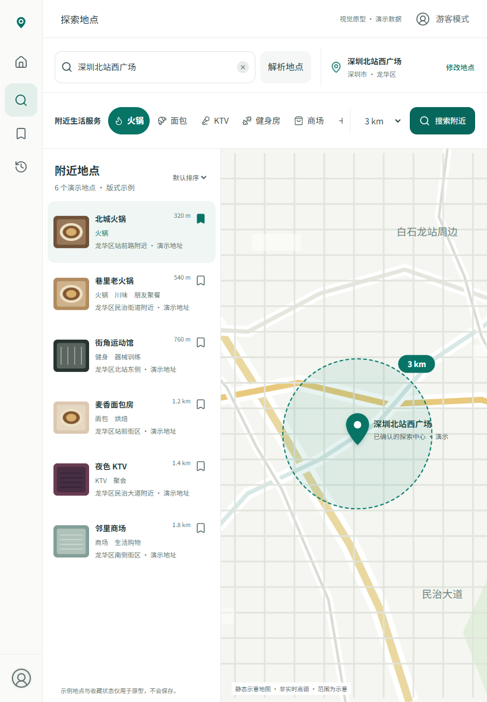
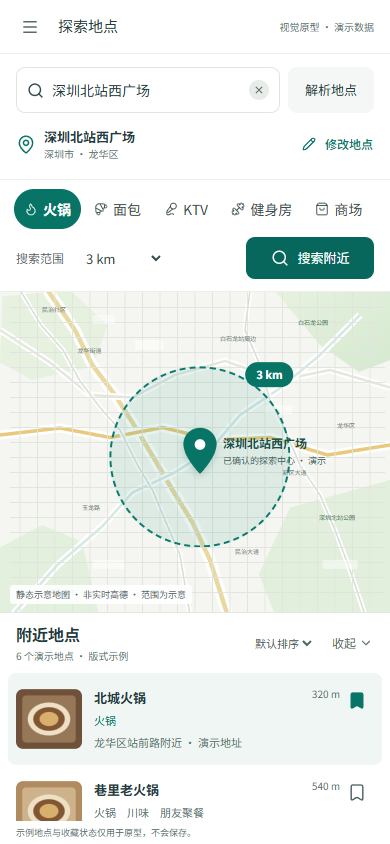

# Issue #8 Stage A — visual review packet

**Awaiting product-owner visual approval. Stage B is not authorized or implemented.**

Runnable entry: http://127.0.0.1:3190/prototype/explore . In the prototype worktree run `npm run dev -- --port 3190 --hostname 127.0.0.1`. On a clean checkout, `npm ci --ignore-scripts` installs the unchanged lockfile; this isolated route needs no database, provider key, Prisma generation or environment file. The current local entry is served from the verified production build on port3190.

The only visual authority is `docs/design/nearby-explore-v2-reference.svg` at c46fac4452cb6cceab0d2edf88350302e733c7ee, blob af7d2ff764c1645061950df38d7808ac54dd25f6. It was read and opened in Chrome before coding. `reference-desktop.png` is a browser render of the SVG, explicitly a reference, not an implementation screenshot. The three files below are actual browser screenshots of React UI.

| Desktop 1440×900 | Tablet 820×1180 | Phone 390×844 |
| --- | --- | --- |
|  |  |  |

## SVG comparison / self-review

| Criterion | Observed result / intentional adaptation |
| --- | --- |
| Desktop composition | Navigation220px; header64px; search92px; toolbar94px. Main workspace x220/y250, list440px, map780×650 — matches SVG boundaries. |
| Integrated surface | White workspace, subtle separators, no bordered result cards; only selected row has pale teal tint. Search field and necessary controls retain reference corner language. |
| Search and conditions | Input/parse/confirmed summary/edit remain together; categories/more/radius/search occupy one desktop row. Extra demo disclosure prevents confusion with live data. |
| Category policy | Reuses all10 existing keys unchanged; example coffee/bookstore replaced by actual bakery/mall categories. No new limit or category definition. |
| Results | Vertical list, illustrative thumbnails, name/category/distance/address and memory-only bookmark presentation. Six demo entries; no invented live-result statistic. |
| Map | Static map layer derived from approved SVG, with visible illustrative/not-live disclosure. Exactly one center pin and one dashed translucent circle. Radius selector scales the circle and label; no geographic accuracy claim or merchant/result pins. Selecting a row changes only its highlight. |
| Typography / colors | Reference font stack with installed Microsoft YaHei fallback; #087466/#08675c teal, #fafaf8 sidebar, #f5f6f1 map, #eff6f3 selection, soft separators. Primary16px and list15px, result heading21px. No font/CDN dependency added. |
| Tablet |72px icon navigation,300px list,448px map; toolbar category strip scrolls. Distances retained. |
| Phone |54px header,126px search/summary,112px two-row toolbar;390×320px map above390×232px expandable result panel. Categories scroll horizontally; range/search remain reachable. No page overflow. |
| Focus / interaction | Candidate, categories and navigation dialogs close with Escape and restore focus. Local demo filtering, range geometry, row selection and reset-on-refresh are exercised. |

Final Playwright run: **17/17 PASS**,43.5s,0 flaky/skipped — 3 prototype viewports +14 unchanged business regression cases. [Browser summary](browser-summary.json) is extracted from the actual report; [verification manifest](verification.json) records dimensions, source/image hashes and check boundaries. Geometry JSONs are measured DOM rectangles. `business-regression/` holds regression screenshots separately from historical evidence.

Functional verification and visual review are distinct: lint/type checks,103 existing Node tests and production build passed, but this packet is **self-review evidence**, not product-owner approval or independent visual acceptance.

## Demo / known limits

All six names/addresses/distances are authored fixtures, not API results. Parse uses one fixed simulated candidate; search filters fixtures in memory; bookmarks reset on reload. Other navigation entries/guest state are presentation only. No business API requests, visitor/history writes, database, external tiles, real SDK, account/favorite/list persistence or map-result linkage. Map scale is illustrative; base map zoom/pan controls were omitted instead of showing nonfunctional SDK buttons. Mobile/browser evidence is Windows Chrome viewport testing, not physical phones/soft keyboards or Firefox/WebKit.

Full production build/type checks also validate existing database routes and need the existing generated Prisma Client; verification used only the repository CI's non-sensitive localhost placeholders inside child processes. No environment file or actual configuration/credentials changed, no DB connection/migration. First setup attempt lacked DIRECT_URL, then generation succeeded with this isolated CI placeholder. Initial UI tests caught a whitespace-sensitive test locator and mobile-dialog focus restoration; corrected and full suite rerun. Existing dependency audit remains5 high+1 critical; no dependency upgrade/audit fix was performed.

## Files and delivery boundary

New route/CSS: `app/prototype/explore/{page.tsx,prototype.css}`. New UI: `src/components/prototype/explore-prototype.tsx`. Static art: `public/prototype/illustrative-map.svg` (approved-SVG-derived roads/labels only). Tests: `test/browser/prototype.spec.ts`. One shared-shell branch bypass in `src/components/app-shell.tsx` applies only to this prototype URL. Instructions/records updated in AGENTS/PLANS/root README/Harness. **No new dependencies; package/lock unchanged.**

Development branch `codex/nearby-explore-prototype`, separate Worktree `C:\Users\lenovo\.codex\worktrees\nearby-explore-prototype\地点聚合器`. Any review PR targets `design/nearby-explore-v2-reference`, draft, Stage A only; no broad PR to master. Existing CI only triggers master-targeted PRs/master pushes, so this draft does not trigger it; local executed checks are reported separately. PR #5 and original checkout remain unchanged. No merge/production deployment and no Issue auto-close. Preview availability/protection status is reported on the prototype PR after push.
